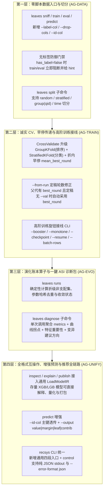

# leaves Agentic 化演进方案

> **文档类型**：可执行演进方案（面向「Agentic GBDT/XGBoost 库」目标收口）  
> **版本**：v2.2<br>
> **日期**：2026-11-05（增补 §十八 全链路 Agentic 易用性与架构纵深审阅）<br>
> **进度**：**Phase 0–5 全部落地**；POST-01/02/03/10/14/15 加固（skills CI、cv_conflict、文档对齐、错误码表）；**§十六 EVO 已落地**（2026-08-15：SKILL §4.5 演化搜索协议 + 账本信号 + 测试锁定）。**§十七 RC 已落地**（2026-08-21：RC-00..12 控制面契约 + 监控 + 发布状态机 + fake adapter + 八段端到端演练；指南 [`docs/recsys-loop.md`](docs/recsys-loop.md)）。**§十八 AG-NEXT 已立项规划**（2026-11-05：面向真实业务全链路的七大易用性断层修复与 Phase 6 工作包）。


> **审计基线**：Agentic 达成度审计（约 80–85% 主干已成）  
> **上位文档**：[`演进计划.md`](演进计划.md) v5.4（库稳定 / 平台化 12 个月路线图）  
> **执行 backlog 容器**：[`TODO.md`](TODO.md)  
> **Agent 规约**：[`AGENTS.md`](AGENTS.md)  
> **闭环方法论文档**：[`skills/leaves-autotrain/SKILL.md`](skills/leaves-autotrain/SKILL.md)

---

## 目录

- [一、文档定位与关系](#一文档定位与关系)
- [二、目标陈述与成功定义](#二目标陈述与成功定义)
- [三、现状基线（2026-07-10）](#三现状基线2026-07-10)
- [四、问题排序与根因](#四问题排序与根因)
- [五、设计原则（不可妥协）](#五设计原则不可妥协)
- [六、目标架构（目标态）](#六目标架构目标态)
- [七、分阶段演进路线](#七分阶段演进路线)
- [八、工作包详单（WP）](#八工作包详单wp)
- [九、契约规范（Agent 信号层）](#九契约规范agent-信号层)
- [十、测试与验收矩阵](#十测试与验收矩阵)
- [十一、文档与技能发现治理](#十一文档与技能发现治理)
- [十二、里程碑、排期与依赖](#十二里程碑排期与依赖)
- [十三、风险、非目标与退出条件](#十三风险非目标与退出条件)
- [十四、完成定义（DoD）总表](#十四完成定义dod总表)
- [十五、落地检查清单（给执行 Agent）](#十五落地检查清单给执行-agent)
- [十六、优化方法论对标与升级（演化 / GEPA）](#十六优化方法论对标与升级演化--gepa)
- [十七、Agentic 推荐生产闭环审阅与演进](#十七agentic-推荐生产闭环审阅与演进)
- [十八、全链路 Agentic 易用性与架构纵深演进（Phase 6 / AG-NEXT）](#十八全链路-agentic-易用性与架构纵深演进phase-6--ag-next)

---

## 一、文档定位与关系

### 1.1 本文解决什么

[`演进计划.md`](演进计划.md) 回答：**库本身如何更稳、更清晰、更可扩展**。  
**本文**回答：**如何把 leaves 收口成「算法工程师通过 Agent Loop 即可自动化完成训练 → 测试验证 → 打包发布」的 Agentic GBDT/XGBoost 库**。

两者互补，不互相替代：

| 文档 | 主线 | 时间尺度 |
|------|------|----------|
| 演进计划 v5.4 | 入口统一、扩展点、BackendAuto、互操作边界、v2.1 | 12 个月 |
| **演进方案（本文）** | Agent 闭环契约、CLI 鲁棒性、技能发现、发布工件、验收门禁 | **6–10 周收口 + 可选深化** |

### 1.2 阅读对象

- 执行实现的人类工程师 / 编码 Agent  
- 评审「是否可对外宣称 Agentic」的负责人  
- 维护 `skills/leaves-autotrain` 的文档所有者  

### 1.3 状态约定

| 标记 | 含义 |
|------|------|
| `[ ]` | 未开始 |
| `[~]` | 进行中 |
| `[x]` | 完成 |
| `[-]` | 明确不做（见 §十三） |

进度同步以 [`TODO.md`](TODO.md) 追加「Agentic 收口」小节为准；本文保留方案与验收口径。

---

## 二、目标陈述与成功定义

### 2.1 一句话目标

> **leaves = 纯 Go 的 GBRT 训练/推理库 + Agent 可驱动的黑盒目标函数**；  
> 算法工程师只需提供数据和业务指标目标，Agent 依据 SKILL 调用 CLI，即可完成 **嗅探 → 训练 → 调参循环 → 验证 → 诊断 → 本地打包发布**，全程不写 Go 业务代码。

### 2.2 角色分工（不变）

```text
┌─────────────────────┐     shell + JSON      ┌─────────────────────┐
│  Agent（优化器）      │ ──────────────────►  │  leaves CLI / 库     │
│  · 读 SKILL 决策表   │                      │  · sniff/train/eval  │
│  · 读 metrics/runs  │ ◄──────────────────  │  · predict/explain   │
│  · 决定下一组超参    │   metrics.json 等     │  · inspect/publish   │
└─────────────────────┘                      └─────────────────────┘
```

- **搜索逻辑在 SKILL 文本**，不在 leaves 代码（与「不内置 HyperparamSearch」一致）。  
- **CLI 只保证信号诚实、可复现、可审计**；不替 Agent 做贝叶斯优化。

### 2.3 成功定义（对外可宣称）

满足 **全部** 下列条件，方可宣称「Agentic 化目标明确达成」：

| ID | 成功条件 | 度量 |
|----|----------|------|
| S1 | 零 Go 代码闭环可跑通 | 任意 Agent 仅用 shell + 读 JSON 完成 demo 全链路 |
| S2 | 信号契约无歧义 | metrics/runs/sniff schema 有文档 + 测试锁定；关键字段可复现最优 run |
| S3 | 最优模型定稿无陷阱 | 早停路径下，发布模型与 `best_round` 语义一致（或 CLI 强制定稿路径） |
| S4 | 技能可被主流 Agent 发现 | `leaves-autotrain` 与 recsys 对称出现在 skills 与 Cursor skills |
| S5 | 回归门禁覆盖「优化环」 | 不止单轮 smoke，含多轮 train+runs 选优 + publish |
| S6 | 边界对外写实 | README/SKILL 明确：本地工件包 ≠ registry；数据前置要求；非目标列表 |
| S7 | 库身份不被削弱 | Native golden、XGB 互操作、训练主干能力不因 Agentic 改动退化 |

### 2.4 非成功（避免过度承诺）

以下 **不作为** 本方案成功条件：

- 内置 Optuna / 网格搜索 / AutoML 服务  
- 官方 model registry / OCI 推送 / 在线 serving 平台  
- 任意脏数据（缺失、类别、文本）零清洗即训  
- 分布式训练  

### 2.5 推荐系统的双层完成口径（2026-08-20 新增）

本文此前的「Agentic 达成」是指：Agent 能基于可靠 CLI/JSON 契约，完成**离线监督学习模型**的训练、验证、优化和本地工件打包。该口径已经达成，不能扩大解释成「生产推荐平台已经闭环」。

| 层级 | 已有/目标 | 完成口径 |
|------|-----------|----------|
| **离线推荐流水线** | 已有：四元数据准备 → 候选召回 → LTR 排序 → 发牌 | 可重复生成 `deal` 终稿，且候选数、NDCG、去重与 Tag 约束经测试验证 |
| **Agentic 推荐生产闭环** | 已达成（2026-08-21）：快照/决策/曝光/反馈/证据契约 → 三层离线门禁 → 账本 → 归因回放 → 监控触发器 → 受控发布状态机 + adapter 请求（`recsys/{contract,split,eval,ledger,replay,monitor,release}` + CLI） | 每次线上决策可追溯到数据、特征、模型和策略版本；每次推广均经离线门禁，异常可停止或回滚（请求由应用侧 adapter 执行） |

对外表述口径（写实边界）：leaves 提供**离线推荐流水线 + 可审计控制面契约**，
可对接外部 serving/registry/CI 受控执行；leaves 本身不托管「完整线上推荐系统」或
「自动在线学习平台」（见 §十七 风险与非目标）。

---

## 三、现状基线（2026-07-10）

### 3.1 已具备（主干 ~80–85%）

| 层 | 现状 | 依据 |
|----|------|------|
| **库本体** | 纯 Go 训练+推理；XGB/LGB 加载；XGB JSON 导出；Born；解释；量化；WASM | README、train/、io/、explain/、quantize/ |
| **CLI** | `sniff|train|eval|predict|inspect|explain|publish` | `cmd/leaves/` |
| **闭环信号** | metrics.json、runs.jsonl、emit-rounds、manifest | `cmd/leaves/common.go`、cli.md |
| **SKILL** | leaves-autotrain 决策表 + walkthrough；recsys 四段流水线 | `skills/` |
| **Demo** | examples/autotrain 可抄命令跑通 | `examples/autotrain/` |
| **测试** | train→eval→predict→publish smoke；paths/emit/explain 等 | `cmd/leaves/*_test.go`（本地 `go test ./cmd/leaves` 通过） |

### 3.2 审计发现的关键缺口（按严重度）

| 优先级 | 缺口 | 用户/Agent 可见症状 | 根因类型 |
|--------|------|---------------------|----------|
| P0 | sniff `n_features` 错误 | 3 特征数据报 `n_features=2`，与 `feature_names` 矛盾 | 契约 bug |
| P0 | `params` 账本不完整 | runs.jsonl 无法复现最优超参（缺 subsample 等） | 契约缺口 |
| P0 | 早停不回滚模型 | Agent 发布 final-round 而非 best-round | 语义陷阱 |
| P1 | leaves-autotrain 未进 `.cursor/skills` | Cursor Agent 默认只发现 recsys | 可发现性 |
| P1 | 无「多轮优化环」集成测试 | 文档 walkthrough 无 CI 锁 | 验收缺口 |
| P1 | 演进计划未把 Agentic 作里程碑 | 对外叙事仍偏「库稳定」 | 文档/治理 |
| P2 | 发布仅为本地包 | 「发布」体感弱于 MLOps 期望 | 边界/扩展点 |
| P2 | 数据前置要求硬 | 缺失/类别直接失败 | 产品摩擦（可选缓解） |
| P2 | smoke 未强制 sniff+runs 路径 | 回归面偏窄 | 测试 |

### 3.3 实测对照（审计日）

在 `examples/autotrain` 上验证：

```text
sniff  → suggested_objective=reg:squarederror  ✓（但 n_features 异常）
train  → metrics.json + model                   ✓
eval   → holdout metrics                        ✓
publish→ model + quant + xgb + manifest         ✓（parity pass）
```

结论：**路径通，契约未收口**。

---

## 四、问题排序与根因

### 4.1 根因分类

```text
契约层  ──►  Agent 读到的 JSON 与真实语义不一致（特征数、params、best model）
发现层  ──►  SKILL 存在但入口不对称（Cursor vs skills/）
验收层  ──►  有单轮 smoke，无「优化环」回归
叙事层  ──►  能力已实现，未写入可验收的产品里程碑
体验层  ──►  数据与发布边界合理，但缺少「失败即提示下一步」的 Agent 友好错误
```

### 4.2 为什么优先契约层

Agent Loop 的正确性完全依赖：

1. **读到的数是否真**（metrics / sniff）  
2. **记下的参是否全**（runs params）  
3. **存下的模型是否对**（early-stop / best_round）  

三者任一失真，优化环在表面上「跑完了」，实际上在优化噪声或发布错误模型。  
因此本方案 **Phase 0–1 只做契约与定稿语义**，不扩新功能面。

---

## 五、设计原则（不可妥协）

1. **Agent 即优化器，leaves 即目标函数**  
   - 禁止把网格/贝叶斯搜索做进库核心。  
   - 允许 CLI 提供「定稿便利」（如 `--save-best`），这是语义修正，不是搜索。

2. **JSON 是唯一闭环信号**  
   - stderr 仅给人看；Agent 只依赖退出码 + 结构化文件。  
   - 所有 Agent 可读字段必须有 schema 文档 + 测试。

3. **可复现优先于魔法**  
   - 同 seed + 完整 params → 指标与树数可复现。  
   - 账本只读追加；Agent 不手写 runs.jsonl。

4. **Native 仍是正确性 golden**  
   - Agentic 改动不得破坏 parity / 训练回归。

5. **模块化、Go 优先**  
   - 新逻辑优先落在 `cmd/leaves` 与已有包；不引入 MCP 运行时依赖。  
   - 推荐域能力继续走 recsys SKILL + `recsys/` 包，不与通用 autotrain 耦合。

6. **明确不做的继续不做**  
   - 见 §十三；边界变化必须同步 README + SKILL + 本文。

---

## 六、目标架构（目标态）

### 6.1 Agent Loop 目标态

```text
  ┌────────────────────────────────────────────────────────────────┐
  │ 0. 工作区初始化：runs.jsonl 空账本 + 输出目录                    │
  │ 1. sniff → 任务类型 / 特征维 / 建议 objective（字段一致）         │
  │ 2. train --cv（诚实基线）→ metrics + 可选全量模型 + 账本行       │
  │ 3. train --val --early-stop --emit-rounds（诊断）                │
  │    · metrics 含 best_round / train_metric / value                │
  │    · 模型语义：best 或 CLI 明确 final（见 WP-03）                │
  │ 4. Agent 读 runs.jsonl → 完整 params 复现/比较 → 决策表调参      │
  │ 5. 收敛 → inspect + eval(holdout) → publish                      │
  │ 6. manifest 含 metrics 快照 + 文件 sha256 + 可选 post 钩子说明    │
  └────────────────────────────────────────────────────────────────┘
```

### 6.2 组件边界（目标态）

| 组件 | 职责 | 不负责 |
|------|------|--------|
| `cmd/leaves` | 子命令、JSON 契约、退出码、本地 publish | 搜索策略、远程 registry |
| `skills/leaves-autotrain` | 决策表、收敛、walkthrough | 执行代码 |
| `.cursor/skills/leaves-autotrain` | 与上镜像或软链，供 Cursor 发现 | 第二套语义 |
| `train/` / `data/` / `io/` | 训练与 IO 语义真源 | Agent 文案 |
| `examples/autotrain` | 可复制闭环 demo | 生产数据管线 |
| 用户 CI | 推 registry / 部署 | — |

### 6.3 工件包目标态（publish）

```text
<out-dir>/
  model.leaves.json          # 主模型（与 best 语义一致）
  model.xgb.json             # 可选 --export-xgb
  model.quant.json           # 可选 --quantize 侧车
  quantize_report.json       # 可选 parity
  manifest.json              # version, objective, n_trees, files[], metrics, created_at
  # 可选（WP-11）：
  # REPRODUCE.md 或 manifest.reproduce 命令模板
```

---

## 七、分阶段演进路线

总周期建议：**6–10 周** 完成「明确达成」；其后按需深化。  
与演进计划 Phase A–E **并行不冲突**：本文 WP 多落在 `cmd/leaves` / skills / 测试，少动 IR 与 BackendAuto。

```text
Phase 0  契约急救（3–5 天）     ──► 信号不再骗人
Phase 1  定稿语义（1–2 周）     ──► 发布模型 = 最优模型
Phase 2  发现与验收（1–2 周）   ──► Agent 找得到 + CI 锁得住
Phase 3  体验与边界（2–3 周）   ──► 错误可行动 + 发布可对接
Phase 4  宣称与治理（3–5 天）   ──► 对外「明确达成」
Phase 5  可选深化（按需）       ──► 摩擦下降，不破原则
```

### Phase 0 — 契约急救（P0）

**目标**：Agent 读到的 JSON 与事实一致。  
**出口**：S2 中「sniff 一致 + params 完整」满足。

| WP | 标题 | 预估 |
|----|------|------|
| WP-01 | 修复 sniff `n_features` / 字段一致性 | 0.5d |
| WP-02 | 补全 `paramsRecord` 与 runs/metrics 全量旋钮 | 1d |
| WP-00 | 契约回归测试（锁定 schema 关键字段） | 1d |

### Phase 1 — 定稿语义（P0）

**目标**：早停路径下不会默默发布次优模型。  
**出口**：S3 满足。

| WP | 标题 | 预估 |
|----|------|------|
| WP-03 | 早停 best 模型语义（`--save-best` 或等价） | 2–3d |
| WP-04 | SKILL / cli.md / walkthrough 同步定稿流程 | 0.5d |
| WP-05 | 定稿路径单测 + 文档反例下线 | 1d |

### Phase 2 — 发现与验收（P1）

**目标**：技能可发现；优化环有 CI。  
**出口**：S4、S5 满足。

| WP | 标题 | 预估 |
|----|------|------|
| WP-06 | 同步 `leaves-autotrain` 到 `.cursor/skills` | 0.5d |
| WP-07 | 多轮优化环集成测试 | 2d |
| WP-08 | examples/autotrain 与 SKILL walkthrough 数字复跑刷新 | 1d |
| WP-09 | AGENTS / README / 演进计划交叉引用本方案 | 0.5d |

### Phase 3 — 体验与边界（P1–P2）

**目标**：失败可行动；发布边界清晰且可对接。  
**出口**：S6 加强；工程师摩擦下降。

| WP | 标题 | 预估 |
|----|------|------|
| WP-10 | Agent 友好错误码/错误 JSON 片段 | 2d |
| WP-11 | publish 可复现清单（reproduce 块 / 可选 post 钩子文档） | 1–2d |
| WP-12 | 数据前置检查增强（sniff 报告缺失/非数值风险） | 2d |
| WP-13 | recsys 与 autotrain 边界对照表（文档） | 0.5d |

### Phase 4 — 宣称与治理

**目标**：可对外写「明确达成」。  
**出口**：S1–S7 全绿 + 发布检查表签字。

| WP | 标题 | 预估 |
|----|------|------|
| WP-14 | Agentic 验收清单跑通（§十四） | 1d |
| WP-15 | README 首页 Agentic 段落升级为「已达成 + 边界」 | 0.5d |
| WP-16 | TODO.md 追加 Agentic 收口存档；本文状态更新 | 0.5d |

### Phase 5 — 可选深化（不阻塞宣称）

| WP | 标题 | 说明 |
|----|------|------|
| WP-17 | train 支持从 runs 行「一键复现」`--from-run` | 降低 Agent 拼 flag 错误 |
| WP-18 | metrics schema 版本字段 `schema_version` | 长期兼容 |
| WP-19 | publish 可选 `--emit-repro-script` | 生成 PowerShell/bash 复现脚本 |
| WP-20 | 轻量数据建议（缺失值简单填充仅 CLI 层 opt-in） | **默认关闭**；避免静默改分布 |
| WP-21 | 与演进计划 Phase A 合并的入口文档瘦身 | 避免双叙事 |

---

## 八、工作包详单（WP）

每个 WP 含：**背景、改动点、实现要点、测试、验收、风险**。

---

### WP-01 — 修复 sniff `n_features` 一致性

**背景**  
`data.Dense.NumCol()` 返回的是特征列数，标签在 `Labels()`。`cmd/leaves/sniff.go` 在 `hasLabel` 时执行 `nFeat = nCols - 1`，导致 3 特征 CSV 报 `n_features=2`，与 `feature_names` 长度矛盾。

**改动文件（预期）**

- `cmd/leaves/sniff.go`
- `cmd/leaves/paths_test.go` 或新增 `sniff_test.go`
- `skills/leaves-autotrain/cli.md`（示例 JSON 如需）

**实现要点**

```text
对 Dense/CSR 等「标签与特征分离」的 Matrix：
  n_features = dm.NumCol()
  n_cols 语义二选一并写死：
    A) n_cols = n_features（推荐，与 Matrix 一致）
    B) n_cols = n_features + (has_label ? 1 : 0) 表示「文件逻辑列」
禁止再对 NumCol() 无条件 -1。

排序 FormatRanking：
  保持 qid+label 扣除逻辑，但用独立字段说明：
  n_features / has_qid / has_label，避免魔法 -2 无注释。
```

**验收**

- [x] `examples/autotrain/data/train.csv`：`n_features==3`，`len(feature_names)==3`
- [x] ranking 样例：`n_features` 与真实特征维一致
- [x] 单测锁定上述行为（`TestSniffFeatureDimContract`）

**风险**：若外部脚本已依赖错误的 `n_features`，属 bugfix，允许破坏错误依赖；在 NOTES 记一笔。

---

### WP-02 — 补全 params 账本

**背景**  
`paramsRecord` 仅含 rounds/depth/lr/lambda/tree_method/seed，Agent 调 subsample/min_child_weight 等后无法从 runs.jsonl 复现。

**改动文件**

- `cmd/leaves/common.go`（`paramsRecord`）
- `cmd/leaves/train.go`（填充全部 flag）
- `skills/leaves-autotrain/cli.md` schema
- 相关测试

**实现要点：params 最小完备集**

| 字段 | 来源 flag | 备注 |
|------|-----------|------|
| `rounds` | `--rounds` | |
| `depth` | `--depth` | |
| `max_leaves` | `--max-leaves` | omitempty |
| `lr` | `--lr` | |
| `lambda` | `--lambda` | |
| `min_child_weight` | `--min-child-weight` | 映射 MinHessian |
| `gamma` | `--gamma` | |
| `max_bin` | `--max-bin` | |
| `subsample` | `--subsample` | |
| `colsample` | `--colsample` | |
| `tree_method` | `--tree-method` | |
| `seed` | `--seed` | |
| `num_class` | `--num-class` | omitempty |
| `ndcg_k` | `--ndcg-k` | 排序 omitempty |
| `early_stop` | `--early-stop` | 0 可 omit |
| `cv_folds` | `--cv` | 可放 metrics 顶层已有；params 可冗余 |
| `eval_metric` | `--eval-metric` | 建议写入 |
| `objective` | 已在 metrics 顶层 | params 可不重复 |

**验收**

- [x] 任意 CLI 可调旋钮出现在当次 metrics.params 与 runs 行  
- [x] 测试：train 带 subsample/colsample/gamma 后 JSON 含对应键  
- [x] SKILL「从账本复现最优」描述与字段一致  

---

### WP-03 — 早停 best 模型语义

**背景**  
SKILL 已警告：早停不回滚，saved model 是 final-round。Agent 极易漏读并发布过拟合模型。

**方案选择（推荐顺序）**

| 方案 | 描述 | 推荐度 |
|------|------|--------|
| **A. `--save-best`（默认 true 当 early-stop>0）** | Fit 结束把 booster 回滚到 best_round 再 Save | **推荐** |
| B. 仅文档强制重训 | 保持现状，强化 SKILL | 不够，审计已证明陷阱真实 |
| C. 同时存 `model.best.json` + `model.final.json` | 清晰但产物复杂 | 可选增强 |

**推荐实现（A）**

1. 评估 `train.Learner` / EarlyStopping 是否已暴露 `BestRound` 与可回滚状态。  
2. 若训练循环可在内存保留 best 快照：优先快照恢复（避免二次训练成本）。  
3. 若不可：CLI 在 early-stop 触发后自动 `NumRound=best_round` 重训一次并 Save（正确优先于性能；小数据可接受）。  
4. metrics 始终写：  
   - `best_round`  
   - `stopped_round`（实际停下的轮）  
   - `model_round`（写入文件的树数，必须 == best 若 save-best）  
5. 提供 `--save-best=false` 保留研究用 final 模型。

**改动文件（预期）**

- `train/` 早停与模型快照相关  
- `cmd/leaves/train.go`  
- 测试：`cmd/leaves` + 必要时 `train/*_test.go`  
- SKILL 附录 walkthrough 删除「必须手写重训」为唯一路径（改为可选/自动）

**验收**

- [x] `--val --early-stop` 且 val 先降后升时：磁盘模型树数 == `best_round`（默认）  
- [x] metrics.`model_round` 与 inspect `n_trees` 一致  
- [x] `--save-best=false` 行为有单测  
- [x] 不破坏无 early-stop 路径  

**风险**：回滚语义若与 XGBoost 默认不一致，必须在 cli.md 写明 leaves 选择。  
**实现注记（v2.1+）**：默认路径为 **内存截断**（`ApplyBestRound`），非按 best_round 二次重训。

---

### WP-04 / WP-05 — 文档与定稿测试

- 更新 SKILL §五 / 附录：定稿以 CLI 默认为准。  
- walkthrough 改为「自动 save-best」流程，保留一小节解释 final vs best。  
- 测试覆盖：emit-rounds 的 best 与存盘模型一致。

---

### WP-06 — 技能发现对称

**动作**

```text
skills/leaves-autotrain/     # 真源（canonical）
.cursor/skills/leaves-autotrain/  # 镜像或构建同步
```

**实现策略（二选一，推荐 1）**

1. **复制 + CI 校验内容哈希一致**（Windows 友好）  
2. 文档规定「只维护 skills/，发布前脚本 sync」

**验收**

- [x] Cursor 技能列表可见 `leaves-autotrain`  
- [x] 描述字段触发词含：自动训练、调参、publish、metrics.json  
- [x] 与 recsys 并列，不互相覆盖  
- [x] `TestSkillsMirrorSync`：`skills/` ↔ `.cursor/skills/` 哈希一致（POST-01；镜像入库）

---

### WP-07 — 多轮优化环集成测试

**目标测试名（建议）**：`TestAgenticOptimizeLoopSmoke`

**剧本（固定 seed，小数据）**

```text
1. 写临时 CSV（或用 examples/autotrain 子集）
2. sniff → 断言 suggested_objective
3. train tag=baseline --cv 3（或小 rounds 单次）→ runs 1 行
4. train tag=tune1 改 depth/lr → runs 2 行
5. 解析 runs.jsonl，按 maximize 选最优 tag
6. 用最优 params 再 train 出 final model（或依赖已 save 的 model 路径字段）
7. eval holdout
8. publish → manifest 含 sha256 与 metrics
9. 断言：最优 value 不劣于 baseline（或符合固定合成数据单调预期）
```

**注意**

- 短时：`-short` 可降 rounds。  
- 不依赖网络。  
- 失败信息打印完整 metrics，便于 Agent 修测试。

---

### WP-08 — Demo 与 walkthrough 数字刷新

- 在 WP-01–03 完成后重跑 `examples/autotrain` 全流程。  
- 更新 SKILL 附录中的示例数值，避免「文档数字与实跑不符」二次失信。  
- README demo 段与 examples README 对齐同一套命令。

---

### WP-09 — 文档交叉引用

| 文档 | 动作 |
|------|------|
| `AGENTS.md` | 增加「Agentic 演进」链接到本文 |
| `README.md` | Agent 小节指向本文验收口径与边界 |
| `演进计划.md` | 在「相关文档」或 Phase A 增加：Agentic 收口见演进方案 |
| `TODO.md` | 新增「Agentic 收口」checklist，勾选跟 WP |

---

### WP-10 — Agent 友好错误

**目标**：失败时 Agent 不必解析人类散文日志。

**建议形态**

- 退出码保持：`1` 参数/IO；`2` 训练/评估内部错误。  
- 可选：`--error-format json`（默认关闭，避免破坏现有管道）输出：

```json
{
  "error": "missing_label",
  "message": "CSV has no label column",
  "hint": "name a column label/target/y/class or place label last",
  "retryable": false
}
```

**优先覆盖错误类**

| code | 场景 |
|------|------|
| `usage` | 缺 flag |
| `data_load` | 路径/格式 |
| `non_numeric` | 类别字符串 |
| `missing_value` | 空单元格 |
| `objective_mismatch` | multi 无 num-class |
| `cv_conflict` | cv 与 val 组合被忽略时 **升级为可配置 strict** |

**Phase 3 可先做「高频 5 类」**，不必一次完美。

---

### WP-11 — publish 可复现与对接

**最小交付**

- `manifest.json` 增加：  
  - `leaves_version` 或 build 信息（若可得）  
  - `reproduce`: 建议命令字符串（由 params 生成）  
  - `metrics` 已有  

**文档交付**

- cli.md 增加「如何把 out-dir 推到你的 registry」模板（gh release / s3 cp / 内部 API）—— **代码不实现推送**。  

**可选代码**

- `--print-repro` 打印一条完整 `leaves train ...` 命令到 stdout。  

---

### WP-12 — sniff 数据风险报告

在不自动改数据的前提下，让 Agent 预知失败：

```json
"data_quality": {
  "numeric": true,
  "missing_cells": 0,
  "constant_features": ["x7"],
  "warnings": ["label_imbalance_ratio=0.02"]
}
```

实现以抽样扫描为限，避免大文件 OOM；超大文件可 `scanned_rows` 上限。

---

### WP-13 — recsys vs autotrain 边界表

写入 `skills/leaves-autotrain/SKILL.md` 与 `recsys-orchestrator/SKILL.md` 双向链接：

| 场景 | 用哪套 |
|------|--------|
| 任意监督表 / 单模型调参发布 | leaves-autotrain |
| 召回→LTR→发牌 | recsys-orchestrator |
| 仅精排模型调参 | autotrain 或 recsys-rank（数据已是 ranking TSV） |

---

### WP-14–16 — 宣称门禁

执行 §十四 DoD 总表，全绿后：

1. README 将 Agentic 描述从「即可完成」改为带版本锚点的「vX.Y 起契约稳定」。  
2. 本文文首状态改为 **已达成（日期）**。  
3. TODO 存档勾选。  

---

### WP-17–21 — 可选深化（摘要）

- **WP-17** `train --from-run runs.jsonl --tag depth6_lr01`：解析该行 params 填默认，CLI 覆盖优先。  
- **WP-18** `"schema_version": 1` 写入所有 metrics 类 JSON。  
- **WP-19** publish 生成 `reproduce.ps1`。  
- **WP-20** 仅 `--na-policy error|skip-row`（默认 error），不做复杂插补。  
- **WP-21** 与演进计划文档瘦身合并，避免三份路线图打架。  

---

## 九、契约规范（Agent 信号层）

### 9.1 退出码（冻结）

| Code | 含义 | Agent 行为 |
|------|------|------------|
| 0 | 成功 | 读 metrics/out |
| 1 | 参数/用法/IO | 修 flag，不重试同命令 |
| 2 | 训练/评估/内部 | 可降复杂度重试或上报 |

### 9.2 metrics.json（目标 schema v1）

```json
{
  "schema_version": 1,
  "objective": "reg:squarederror",
  "metric": "rmse",
  "value": 0.218,
  "maximize": false,
  "n_rows": 120,
  "n_features": 3,
  "train_metric": 0.13,
  "best_round": 43,
  "stopped_round": 63,
  "model_round": 43,
  "cv_folds": 0,
  "cv_mean": 0,
  "cv_std": 0,
  "fold_metrics": null,
  "params": { "...": "见 WP-02 完备集" }
}
```

**字段纪律**

- `value`：主优化目标；有 val 时为 val；有 cv 时为 cv_mean。  
- `maximize`：Agent 比较方向唯一依据。  
- `model_round`：与磁盘模型树数一致（WP-03 后强制）。  

### 9.3 runs.jsonl

- 一行一次 train；追加写。  
- 含 `tag`, `ts`, `model`, `metric`, `value`, `maximize`, `params`（完备）。  
- Agent **只读不写**。  

### 9.4 sniff 输出

- `n_features` 与 `feature_names` 长度一致（若有 names）。  
- `suggested_objective` / `suggested_metric` 必有。  
- 可选 `data_quality`（WP-12）。  

### 9.5 manifest.json

- 现有字段保留。  
- 增加 `reproduce` / `schema_version`（WP-11/18）。  
- `files[].sha256` 为发布完整性依据。  

### 9.6 契约变更流程

1. 改 schema 先改测试。  
2. 升 `schema_version`。  
3. 同步 cli.md + SKILL。  
4. NOTES 记录兼容说明。  

---

## 十、测试与验收矩阵

### 10.1 测试分层

| 层 | 内容 | 命令 |
|----|------|------|
| 单元 | sniff 特征维、params 填充、save-best | `go test ./cmd/leaves -count=1` |
| 训练语义 | early-stop best 与 Learner 一致 | `go test ./train/... -count=1`（相关 run） |
| 优化环 | WP-07 多轮 smoke | `go test ./cmd/leaves -run Agentic -count=1` |
| 库回归 | 全量不退化 | `go test ./... -count=1` |
| 人工 | examples/autotrain 全流程 | 见 examples README |

### 10.2 Agentic 验收剧本（宣称前必跑）

**剧本 A — 回归 demo（PowerShell）**

```powershell
$RUNS = "examples/autotrain/run_accept"
# 1 sniff  2 train baseline+cv  3 train tune + early-stop
# 4 eval   5 inspect  6 publish --quantize --export-xgb
# 断言：n_features=3；manifest 文件齐全；quantize parity pass
```

**剧本 B — 契约负面**

- 缺 `--objective` → exit 1  
- 非数值 CSV → 可识别错误（WP-10 后）  
- early-stop 场景 model_round == best_round  

**剧本 C — recsys 不回归**

```powershell
go test ./recsys/pipeline/... -run TestSmokePipeline100PerUser -count=1
```

### 10.3 CI 建议

| Job | 是否必须 | 说明 |
|-----|----------|------|
| 现有 `go test ./...` | 是 | 已有 |
| `go test ./cmd/leaves` | 是（已含） | 确保 WP-07 进入默认包测试 |
| skills 镜像哈希一致 | 建议 | WP-06 |
| 不新增 MCP/Python 运行时依赖 | 是 | 保持 Agentic 路径纯 shell |

---

## 十一、文档与技能发现治理

### 11.1 真源层级

```text
契约真源：  cmd/leaves 实现 + cmd/leaves 测试
人读真源：  skills/leaves-autotrain/cli.md
策略真源：  skills/leaves-autotrain/SKILL.md
发现入口：  README / AGENTS / .cursor/skills
路线真源：  本文（Agentic）+ 演进计划（库整体）
```

### 11.2 同步规则

| 变更类型 | 必须同步 |
|----------|----------|
| 新 flag | train.go + cli.md + SKILL 速查卡 |
| metrics 字段 | common.go + cli.md + 测试 + 可选 schema_version |
| 早停语义 | train + SKILL §五 + examples |
| 新子命令 | main.go usage + README Agent 节 + cli.md |

### 11.3 技能触发词（保持）

- 自动训练、调参、优化指标、AutoML、publish、metrics.json、Agent Loop  
- 与 recsys 触发词隔离，避免抢入口  

---

## 十二、里程碑、排期与依赖

### 12.1 建议排期（自方案批准日起）

| 里程碑 | 时间 | 交付 | 出口 |
|--------|------|------|------|
| **M0 契约诚实** | 第 1 周 | WP-01,02,00 | sniff/params 测试绿 |
| **M1 定稿正确** | 第 2–3 周 | WP-03,04,05 | save-best 默认正确 |
| **M2 可发现可回归** | 第 3–4 周 | WP-06,07,08,09 | 优化环 CI + skills 对称 |
| **M3 体验边界** | 第 5–7 周 | WP-10,11,12,13 | 错误可行动 + 质量报告 |
| **M4 明确达成** | 第 7–8 周 | WP-14,15,16 | DoD 全绿，对外宣称 |
| **M5 可选** | 按需 | WP-17+ | 不阻塞 M4 |

### 12.2 依赖图

```text
WP-01 ─┐
WP-02 ─┼─► WP-00 ─► WP-07 ─► WP-14
WP-03 ─┘              ▲
  │                   │
  └─► WP-04/05 ───────┘
WP-06 ───────────────► WP-14
WP-08 依赖 WP-01..03 完成后刷新数字
WP-09 可与 M0–M2 并行
WP-10..13 不阻塞 M2，阻塞「体验完美」但不阻塞「契约达成」最小集
```

**最小「明确达成」集合（可对外宣称）**  

> WP-01 + WP-02 + WP-03 + WP-04 + WP-06 + WP-07 + WP-09 + WP-14 + WP-15  

WP-10–13 强烈建议但可标为「达成后的加固」。

### 12.3 与演进计划的并行建议

| 演进计划 | 与本文关系 |
|----------|------------|
| Phase A 文档入口收口 | 与 WP-09/15/21 合并执行，避免两套 README 叙述 |
| Phase B 扩展点 | 独立；勿与 CLI 契约混在同一 PR |
| Phase C BackendAuto | 独立；Agent 默认不感知后端，除非 metrics 增加 accel 字段（可选） |
| Phase D–E | 独立 |

---

## 十三、风险、非目标与退出条件

### 13.1 风险与缓解

| 风险 | 影响 | 缓解 |
|------|------|------|
| save-best 二次训练变慢 | 大轮数成本 | 优先内存快照；文档说明 |
| params 字段膨胀 | 旧 Agent 忽略未知键 | 只增不删；schema_version |
| skills 双份漂移 | 决策表不一致 | CI 哈希 / 单一真源脚本 |
| 过度自动化填补缺失值 | 静默改分布 | WP-20 默认 error |
| 范围膨胀成 AutoML 平台 | 违背库定位 | 非目标清单；评审卡点 |

### 13.2 明确非目标（本方案周期内）

- [-] 内置 HyperparamSearch / Optuna 绑定  
- [-] MCP server 作为闭环必需依赖  
- [-] 官方 registry / 云端实验板  
- [-] 分布式训练  
- [-] 完整特征存储 / 实时特征  
- [-] 把 recsys 召回发牌并进 `cmd/leaves` 主 CLI  

### 13.3 退出与降级

- 若 WP-03 在 train 内核改动风险过高：允许 **CLI 层自动重训 best_round** 作为 v1，内核快照作 v2。  
- 若 Cursor skills 同步机制受限：至少 README + AGENTS 置顶路径，并在 PR 模板要求「改 SKILL 必改镜像」。  

---

## 十四、完成定义（DoD）总表

### 14.1 最小达成集（Mandatory）

| ID | 检查项 | 验证方法 | 状态 |
|----|--------|----------|------|
| D1 | sniff n_features 与 feature_names 一致 | 单测 + autotrain 数据 | [x] |
| D2 | params 含全部 CLI 旋钮 | 单测 JSON 键 | [x] |
| D3 | early-stop 默认保存 best 模型 | 单测 n_trees / model_round | [x] |
| D4 | runs.jsonl 可复现最优 run | 完备 params + manifest.reproduce | [x] |
| D5 | leaves-autotrain 可被 Cursor 发现 | `.cursor/skills` 存在且描述正确 | [x] |
| D6 | 多轮优化环测试默认 `go test ./cmd/leaves` 通过 | CI/本地 | [x] |
| D7 | publish 产物齐全 + quantize parity 可 pass | smoke + demo | [x] |
| D8 | SKILL/cli/README/AGENTS 与实现一致 | 文档 diff 评审 | [x] |
| D9 | `go test ./cmd/leaves -count=1` 全绿 | 本地已验证 | [x] |
| D10 | 边界写清：本地包、无内置搜索、数据前置 | README 专段 | [x] |

### 14.2 加固集（Recommended，不阻塞最小宣称）

| ID | 检查项 | 状态 |
|----|--------|------|
| R1 | `--error-format json` 覆盖高频错误 | [x] |
| R2 | sniff data_quality 警告 | [x] |
| R3 | manifest.reproduce 命令 | [x] |
| R4 | schema_version=1 | [x] |
| R5 | train --from-run | [x] |

### 14.3 对外宣称话术（达成后）

> leaves 是纯 Go 的 GBRT 训练与推理库，并提供 **SKILL 驱动、无 MCP** 的 Agent 闭环：  
> 通过 `leaves sniff/train/eval/predict/inspect/explain/publish` 与 metrics/runs JSON，  
> 算法工程师可借助 Agent Loop 自动完成训练、验证与本地工件发布。  
> 超参搜索策略在 SKILL 中由 Agent 执行；库不内置 AutoML 服务，也不托管 model registry。

---

## 十五、落地检查清单（给执行 Agent）

复制跟踪：

```text
Agentic 演进 Progress:
Phase 0
- [x] WP-01 sniff n_features
- [x] WP-02 params 完备
- [x] WP-00 契约测试
Phase 1
- [x] WP-03 save-best
- [x] WP-04 SKILL 同步
- [x] WP-05 定稿测试
Phase 2
- [x] WP-06 .cursor/skills 镜像
- [x] WP-07 TestAgenticOptimizeLoopSmoke
- [x] WP-08 demo 数字刷新
- [x] WP-09 交叉引用
Phase 3
- [x] WP-10 错误 JSON
- [x] WP-11 publish reproduce
- [x] WP-12 data_quality
- [x] WP-13 边界表
Phase 4
- [x] WP-14 DoD 全跑
- [x] WP-15 README 宣称
- [x] WP-16 TODO/本文状态更新
Optional
- [x] WP-17 train --from-run
- [x] WP-18 schema_version
- [x] WP-19 emit-repro-script
- [x] WP-20 na-policy
- [x] WP-21 文档地图
```

### 15.1 推荐 PR 切片（便于并行与评审）

| PR | 内容 | 合并前提 |
|----|------|----------|
| PR-A | WP-01 + 测试 | 独立 |
| PR-B | WP-02 + cli.md | 独立 |
| PR-C | WP-03 + train 测试 + SKILL | 依赖语义评审 |
| PR-D | WP-06 + WP-09 文档 | 独立 |
| PR-E | WP-07 优化环测试 | 建议在 A–C 后 |
| PR-F | WP-08 数字刷新 | A–C 后 |
| PR-G | WP-10–12 体验 | 可后置 |
| PR-H | 宣称与 TODO 存档 | DoD 绿后 |

### 15.2 单 PR 完成标准

- 测试绿；无无关重构  
- 契约变更必更 cli.md  
- 中文用户可见行为变更必更 SKILL 相关段  
- 不引入内置搜索、不引入 MCP 硬依赖  

---

## 十六、优化方法论对标与升级（演化 / GEPA）

> **触发**：2026-08 方法论审计——把 Agent 闭环的**搜索策略**与演化计算 / GEPA（Genetic-Pareto，反射式提示进化，arXiv:2507.19457）等算法对标后的差距分析。  
> **前提不变**：搜索逻辑仍在 SKILL 文本，leaves 仍是黑盒目标函数；本节只升级「Agent 怎么搜」，不为库加搜索。

### 16.1 对标框架

GEPA 三原则 ↔ leaves 现状映射：

| GEPA 机制 | 含义 | leaves 现状 | 差距判定 |
|-----------|------|-------------|----------|
| 反射式变异（Reflective Mutation） | 读执行轨迹 / 错误信息 / Profiler 等 **ASI**（Actionable Side Information），诊断失败原因后**定向**变异 | ASI 原料已齐：`--emit-rounds` 逐轮曲线、`train_metric` 与 val 差、`explain` 特征重要性、错误 JSON、`data_quality`；但 SKILL 只有静态决策表 + 「卡住恢复表」 | **有原料、无协议**：未规定「组装证据 → 写假设 → 定向变异」 |
| Pareto 候选选择 | 按「每个子任务/实例上的最优」保留非支配候选，按领先数加权随机采样选父，逃局部最优 | `runs.jsonl` 只按全局 `value` 取 current-best 作下一轮起点；`fold_metrics` 已写 metrics 但**未参与选择** | **贪心选择**：等价 GEPA 的 `current_best` 消融组；折级信息浪费 |
| 遗传累积 + Merge | 谱系（lessons 沿祖先累积）与双亲交叉重组 | 「每轮只动 1–2 旋钮」事实上禁止重组；tag 无谱系约定 | **无重组、无谱系** |
| 小批筛选→全量验收 | 先 minibatch 评估，改进才升级全量（样本效率的关键） | 每轮同预算（如 `--cv 5`）；无 screening→promotion | **预算不分层** |
| 预算纪律 B | 显式 rollout 预算上限 | 有收敛判据（连续 3 次 <0.5%），无总轮数帽 | **部分覆盖** |

**结论**：leaves 的「库 = 目标函数、Agent = 优化器」分解与 GEPA 的外置搜索**同构**，且信号诚实度（`schema_version`/`maximize`/`model_round`/seed 可复现）优于多数 GEPA adapter；短板**全部集中在 SKILL 侧搜索策略**——当前本质上是一次**贪心坐标下降**，80% 收益来自开局三步的论断正说明后续搜索效率低。

### 16.2 升级方案（分档）

**Tier 1 — 纯 SKILL 升级（零代码，主交付）**

1. **Hall-of-Fame + 折级 Pareto 选择**：变异父代不再只取全局最优；按 `fold_metrics` 找「在某折上最优」的候选构成非支配集，按领先折数加权随机选父（GEPA illumination 的折级近似）；或 ε-greedy 从 top-3 锦标赛抽取。
2. **反射式变异协议**：候选退化或 plateau 时，强制组装 ASI 包（`rounds.jsonl` 曲线形态、train/val 差、`cv_std`、`explain` 重要性、错误码）→ 写一行假设（记入 Agent 自持的 `decisions.md`；账本仍 CLI 独占，Agent 只读不写）→ 按假设**定向**变异 1–2 旋钮。
3. **交叉重组**：允许从两个前沿候选各取半参（A 的 `depth`/`rounds` + B 的正则/采样），账本去重后评估（GEPA System-Aware Merge 的参数空间对应物）。
4. **筛选→晋级**：新候选先廉价评估（`--cv 2`，或小 rounds + 早停）；优于父代筛查分或差距 <2% 才升 `--cv 5` 全量（successive halving 风味，控总预算）。
5. **预算帽**：默认总训练次数 ≤15（用户可显式放宽）；触帽强制进入 §五收敛流程，防无限调参。

**Tier 2 — 账本信号增强（小代码，可选）**

- **EVO-A**：`runRecord` 增 `n_trees`、`elapsed_ms`、`fold_metrics`（metrics 已有、账本行缺）——使「指标 vs 模型大小/耗时」Pareto 与时间感知筛选可行；**只加信号、不加策略**，与 WP-02 同哲学。
- **EVO-B**：谱系记录。懒实现：tag 命名约定 `p:<父tag>+<变异摘要>`（零代码）；需要强结构再加 `--parent` flag（次优先）。

**已转正**：跨任务 lessons 记忆——v2.6.2 项目级 `lessons.md`；v2.7.0 `leaves lessons add|search|list` 全局库（`~/.leaves/lessons.jsonl`）。自动改写 SKILL 自身仍为远期观察。

### 16.3 工作包（EVO）——已于 2026-08-15 落地

| WP | 标题 | 层 | 预估 | 状态 |
|----|------|----|------|------|
| EVO-01 | SKILL §4.5 搜索协议升级（HoF 选择、反射协议、交叉、筛选晋级、预算帽） | skills 文本 | 1–2d | **[x]** 2026-08-15 |
| EVO-02 | 账本信号增强：runs 行补 `n_trees` / `elapsed_ms` / `fold_metrics` | `cmd/leaves/common.go` + `train.go` | 0.5–1d | **[x]** 2026-08-15 |
| EVO-03 | 优化环测试扩展：锁定账本信号（n_trees/elapsed_ms/fold_metrics；CV 未存模型时 n_trees 合法省略） | `cmd/leaves` 测试 | 1d | **[x]** 2026-08-15 |
| EVO-04 | 谱系：并入 EVO-01 的 tag 约定（`p:<父>+<变异>` / `x:<A>|<B>`），零代码 | 文档 | 0.5d | **[x]** 2026-08-15 |

落地说明：EVO-03 原设想的「非贪心选父可断言」属 SKILL/Agent 行为，Go 测试只能锁信号——已按「锁定 fold_metrics/n_trees/elapsed_ms 存在性」实现；策略正确性由 SKILL walkthrough 与后续实战回归背书。

### 16.4 非目标（延续 §十三）

- [-] 库内置种群维护 / 多目标优化器 / HPO 服务（信号可以更丰富，策略永远在 Agent / SKILL）
- [-] MCP 化或常驻 evolution server
- [-] 自动改写 SKILL 自身（仅作远期观察）

---

## 十七、Agentic 推荐生产闭环审阅与演进

> **审阅日期**：2026-08-20<br>
> **审阅框架**：数据接入 → 候选召回 → 排序训练/评测 → 发牌 → 服务决策/曝光 → 反馈回流 → 监控 → 再训练 → 候选发布/回滚 → 治理。<br>
> **结论（审阅时）**：仓库已具备可回归的**离线四段推荐流水线**和强 Agentic 训练契约；缺口不在 GBDT/LTR 算法，而在推荐业务的时间语义、事件归因、运营观测和受控交付。下一轮应建设“可移植控制面契约”，而非把 registry、serving 或实时系统塞进 leaves 核心。<br>
> **落地（2026-08-21，v2.2）**：§17.3 目标架构的控制面七包（contract/split/eval/ledger/replay/monitor/release）+ shell CLI（`recsys/cmd/control`）+ 八段端到端演练（`recsys/loop`）已全部落地；RD1–RD10 全绿；指南 [`docs/recsys-loop.md`](docs/recsys-loop.md)。

### 17.1 现状审阅：已完成什么，闭环断在哪里

| 链路 | 已有能力与证据 | 当前不足 | 优先级 |
|------|----------------|----------|--------|
| 数据准备 | `recsys.Interaction`/`CatalogItem` 四元契约；`prep.Run` 写 samples、catalog、qid、报告 | `Interaction` 没有事件时间、事件类型、曝光 ID、上下文或来源；按用户切分，不是时间切分；无法表达标签可得性与归因窗 | **P0** |
| 候选召回 | `recall.Run` 按用户偏好 Tag/热度召回，`recall.Validate` 锁定每用户候选数和去重 | 没有 Recall@K、正样本覆盖、长尾覆盖、冷启动分层或候选版本统计；召回不能被离线业务指标单独否决 | **P0** |
| LTR 训练与离线评估 | `rankconv.Run` 生成 group TSV/manifest；`trainrank.Run` 报告 train/test NDCG 并写模型/scored manifest | 标签来自静态交互；缺时间泄漏检查、曝光偏差说明、候选集版本和数据快照指纹；只有 NDCG，缺业务/约束指标门禁 | **P0** |
| 发牌 | `deal.Run` 有 recent 去重、Tag 控重、补位与 JSONL 日志；`deal.Validate` 锁定无重复/无 recent 项 | `DealRow` 只含 User/Item/Tag/Score/Rank；日志没有策略版本、候选来源、规则原因、请求/决策 ID；Tag 上限可因补位软突破 | **P0** |
| 推理服务 | `examples/serving-template` 提供独立 HTTP 推理、就绪检查、热加载和简单计数 | 不是推荐决策 API；`/admin/reload` 明确无鉴权仅演示；无模型选择、候选/发牌审计、限流/认证或推广状态 | **P1** |
| 反馈、监控、再训练 | `metrics.json`、`runs.jsonl`、`publish` manifest 对训练实验可追溯 | 未定义 impression/click/conversion 等反馈契约；无反馈摄取、归因、漂移/质量汇总、触发条件或再训练状态机 | **P0** |
| 发布、回滚、治理 | `leaves publish` 生成带 sha256 和 reproduce 的本地工件包 | 明确只做本地包；没有 candidate/approved/promoted/retired 状态、外部发布适配器、审批证据、灰度/回滚指令或数据保留规则 | **P0** |
| Agent 编排 | `recsys-orchestrator` 已把 prep→recall→rank→deal 写成可运行剧本；`leaves-autotrain` 提供 runs/复现契约 | 剧本在 `deal` 终止；没有读取生产事件、判断告警、重放、推广、停止或回滚的结构化协议 | **P0** |

`recsys/pipeline.RunFromDataset` 已把离线四段串成可重复的 Go 流水线，`TestSmokePipeline100PerUser` 与 `TestMovieLensFourStage` 已覆盖合成和真实数据入口。问题是其输出终点仍是本地 `deal` 文件；它无法代表一次带时间、版本、策略和反馈归因的真实推荐决策。

### 17.2 根因与必须守住的边界

```text
当前：Dataset → prep → recall → rank → deal 文件

目标：可验证数据快照 → 离线候选/排序/发牌 → 候选工件
          ↑                                      ↓
      反馈归因 ← 决策/曝光账本 ← 外部 serving / registry / rollout
          ↓                                      ↓
     监控与重放 ───────── Agent 再训练与推广门禁 ──→ 回滚或提升
```

根因分为四类：

1. **时间与因果缺失**：当前 `Score` 同时承担偏好/标签含义，没有事件发生时间、曝光事实和归因窗口，不能区分“未曝光”与“曝光未点击”，也无法证明训练集只使用决策时已知信息。
2. **工件链断裂**：训练工件有本地校验和，却没有把数据快照、特征契约、候选/发牌策略和上线状态绑定成同一份发布证据。
3. **观测链断裂**：现有日志用于离线调试，未形成 request/decision/exposure/feedback 的可聚合事件；因此不能测量覆盖、欠配、重复、时效、延迟、CTR/CVR 或漂移。
4. **控制链断裂**：Agent 能优化静态离线指标，却没有机器可读的推广前门禁、人工审批点、异常停机和回滚动作。

**边界不变**：

- `leaves` 核心继续只做训练、推理和本地工件；不内置远程 registry、消息队列、数据库、Serving 框架或在线学习服务。
- 推荐控制面采用**纯 Go、可离线测试的结构化契约与 adapter 接口**；具体 Kafka/HTTP/S3/Prometheus/特征库由应用仓库实现。
- 不把在线业务指标伪装成训练指标；没有真实曝光事件时，不得将离线 NDCG 推断成 CTR/CVR 提升。
- 默认保护隐私：事件契约记录稳定的匿名 subject/item 键和必要上下文版本，不要求在 leaves 账本中保存原始 PII、请求正文或敏感特征。

### 17.3 目标架构：库内可测契约，库外可替换基础设施

```text
┌──────────────── leaves / recsys（Go，可单测） ────────────────┐
│ 数据/特征快照 → recall/rank/deal → 离线评估 → candidate bundle │
│       ↑                    ↓               ↑                  │
│  feedback/replay      decision ledger   promotion gate          │
└───────┬────────────────────┬──────────────┬────────────────────┘
        │ JSONL/文件或 adapter │              │ 证据包 / desired state
        ▼                     ▼              ▼
  应用数据仓库           业务 serving    用户 CI / registry / rollout
  （事件、目录、特征）   （鉴权、SLA）   （签名、灰度、回滚）
```

建议的包边界如下，所有写盘格式先固定为 JSONL/JSON；后续由应用适配为流、表或对象存储，不引入强制运行时依赖。

| 新边界（建议） | 职责 | 明确不负责 |
|----------------|------|------------|
| `recsys/contract` | 事件、快照、策略、模型引用和版本字段；兼容性校验 | 连接任意消息系统或数据库 |
| `recsys/eval` | 召回、排序、发牌的分层离线指标与阈值门禁 | 解释线上业务因果 |
| `recsys/ledger` | 决策、曝光、反馈、回滚的 JSONL 账本与关联校验 | 持久化服务、高吞吐采集 |
| `recsys/monitor` | 从账本聚合窗口指标、阈值状态、数据质量/漂移摘要 | Prometheus/Grafana exporter 的强绑定 |
| `recsys/replay` | 按快照和归因窗重建训练样本、离线重放和差异报告 | 实时特征计算 |
| `recsys/release` | 校验候选证据包、生成 adapter-neutral 的 promotion/rollback 请求 | 推 registry、切流或执行远程回滚 |
| `skills/recsys-orchestrator` | 将八段闭环编排为 Agent 的决策剧本 | 将搜索或平台 SDK 写进 leaves |

### 17.4 冻结的核心契约（先于任何平台接入）

所有 ID 都是可匿名化的稳定字符串；每个事件须有 UTC 时间和 schema 版本。新增字段必须向后兼容，旧四元数据可通过显式 `legacy_snapshot=true` 导入，但**不得**进入带时间因果保证的评估门禁。

| 契约 | 最小字段 | 关键不变量 |
|------|----------|------------|
| `DatasetSnapshot` | `snapshot_id`、`schema_version`、`created_at`、输入文件 sha256、`feature_schema_hash`、时间范围、数据用途 | 训练、评估、发布引用不可变快照；特征列顺序/默认值纳入 hash |
| `InteractionEvent` | `event_id`、`occurred_at`、`subject_id`、`item_id`、`event_type`、`value`、`source` | `event_type` 枚举如 impression/click/conversion/rating；不可用未来事件构造当时特征 |
| `DecisionEvent` | `decision_id`、`request_id`、时间、`model_version`、`feature_schema_hash`、`candidate_set_id`、`policy_version`、Top-K 与规则原因 | 每个曝光/反馈可回链到一次具体排序与发牌；不保存原始特征正文 |
| `ExposureEvent` | `exposure_id`、`decision_id`、`item_id`、位置、时间、展示状态 | 反馈归因必须先有曝光；补位/降级须带原因码 |
| `FeedbackEvent` | `event_id`、`exposure_id` 或 `decision_id`、时间、类型、值、归因窗版本 | 未关联曝光的反馈默认不作为 supervised 正样本；迟到事件要可重放 |
| `ReleaseEvidence` | `release_id`、候选模型/量化模型 sha256、`run_id`、snapshot、离线指标、策略版本、门禁结论、审批记录、回滚目标 | 只有 evidence 完整且门禁通过才允许请求外部推广 |

`DealRow` 保留为最终展示行；新增的 `DecisionEvent` 才是审计真源。Tag 超限补位、候选不足、fallback、过滤命中等应统一成为 reason code，而不能只在临时统计日志中出现。

### 17.5 离线可信度门禁：先防止“高 NDCG 的假闭环”

离线评估必须由单一 NDCG 扩展为三层，并把每层结论写入 `ReleaseEvidence`：

| 层 | 必须指标 | 失败时 Agent 行为 |
|----|----------|------------------|
| 数据与时间 | 快照 hash、时间范围、未来特征/重复用户物品/缺失比例、标签成熟度 | 停止训练；修数据或降低为 legacy exploratory run，禁止推广 |
| 候选与排序 | Recall@K、正样本覆盖、NDCG@K/MAP、按新老用户/长尾/Tag 分层、置信区间或重复切分稳定性 | 判断问题位于召回或排序；不得仅调 ranker 掩盖候选失败 |
| 发牌与策略 | deck 满足率、重复率、recent 过滤率、Tag overflow 率、coverage、long-tail/freshness 指标 | 调整策略版本或候选规模；触发 fallback/阻断推广 |

默认使用**时间切分**：`train_end < validation_start < test_start`，并明确特征 as-of 时间、反馈归因窗与迟到事件策略。用户切分仍可保留为 cold-start 附加实验，不能替代主线时间评估。所有阈值是业务配置，不在 leaves 内硬编码；无阈值时工件状态只能是 `exploratory`，不得进入 `candidate`。

### 17.6 观测、反馈与再训练状态机

推荐生产闭环的最小状态机如下；每次状态变迁输出一条机器可读 `run_status.json`/JSONL 事件，Agent 只依赖该结构化信号和退出码。

```text
exploratory
  → candidate (离线数据/召回/排序/发牌门禁均通过)
  → approved  (人工或外部策略批准；记录证据)
  → promoted  (外部 CI/serving 已确认目标版本)
  → observing (按窗口聚合质量、延迟和业务反馈)
  ├→ retrain_requested (新快照、漂移、性能退化或定时策略触发)
  ├→ rollback_requested (硬护栏失败；指向 last_known_good)
  └→ retired (数据/特征/合规条件失效)
```

触发器应是可配置的、带窗口与冷却期的规则，而不是 Agent 的临场猜测：

- **数据触发**：新反馈量达标、目录/特征 schema 改变、快照过期、迟到事件比例超限。
- **质量触发**：召回覆盖、deck 满足率、重复/overflow、长尾/时效护栏下降。
- **线上触发**：由外部应用上报的曝光、点击/转化、延迟、错误率或 drift 摘要连续越界；没有可验证线上事件时只允许离线再训练。
- **安全触发**：模型/特征 hash 不一致、未知 policy/model version、关联缺失或隐私/保留策略失败，立即 `rollback_requested` 或停止曝光。

初始版本必须默认**人工批准**。自动推广只能在应用侧已有签名、访问控制、稳定的监控和已验证 rollback adapter 后，以显式配置开启。`last_known_good` 只引用已经完整记录的 `ReleaseEvidence`，不能按“当前账本最佳 NDCG”隐式选择。

### 17.7 RC 工作包与分期路线

总周期建议为 **7–10 周**；每个包保持 Go 优先、模块化、可离线测试。RC-01..05 是完整生产闭环的最小前置，RC-06..10 把它接入用户的平台而不污染库边界。
**落地状态（2026-08-21）**：RC-00..12 全部完成；控制面指南见 [`docs/recsys-loop.md`](docs/recsys-loop.md)。

| 阶段 | 工作包 | 交付 | 出口 |
|------|--------|------|------|
| **RC0：事实与契约**（1 周） | RC-00 现状基线；RC-01 事件/快照/策略 schema；RC-02 dataset/feature 指纹 | Go 类型、JSONL 编解码、兼容性/PII 规则、样例 fixture | 老四元路径显式标记 legacy；新事件能关联与校验 |
| **RC1：离线可信度**（1–2 周） | RC-03 时间切分/归因窗；RC-04 recall-rank-deal 分层评估与配置门禁 | `recsys/eval`、时间 fixture、`evaluation.json` | 故意引入未来泄漏/候选缺失/Tag 溢出时门禁必失败 |
| **RC2：决策与反馈**（1–2 周） | RC-05 决策/曝光/反馈 ledger；RC-06 回放与训练样本构建 | `ledger.jsonl`、`replay_report.json`、关联完整性校验 | 给定确定输入，重放得到稳定样本和归因统计；孤立反馈不进训练 |
| **RC3：控制面**（2–3 周） | RC-07 监控汇总；RC-08 release evidence/状态机；RC-09 外部 release/rollback adapter 契约 | `monitor_report.json`、`release_evidence.json`、desired-state 请求 | 指标越界能产生确定的 stop/retrain/rollback 请求；不执行网络副作用 |
| **RC4：Agent 与验收**（1–2 周） | RC-10 SKILL 八段剧本；RC-11 端到端故障注入/恢复测试；RC-12 文档与 serving-template 对接说明 | 可复现演练、更新的 `recsys-orchestrator`、用户 CI 示例 | 合成事件从 candidate 到 observing，再经退化回滚；全量 Go 回归通过 |

#### RC 工作包详单

| WP | 最小改动面 | 关键验收 |
|----|------------|----------|
| RC-00 | `recsys/` + `skills/recsys-orchestrator` 现状清单 | 文档精确区分离线 `deal` 与线上 decision；不再暗示已有实时闭环 |
| RC-01 | `recsys/contract` | schema_version、UTC 时间、event/decision/exposure/feedback 关联；重复 ID、未知事件类型和反向时间均失败 |
| RC-02 | `recsys/contract` + workspace manifest | 文件/特征 schema/model/policy hash 进入 snapshot；发布前任一 hash 不匹配失败 |
| RC-03 | `recsys/prep` 或新增 split 包 | 显式 as-of cutoff；训练样本不得读取 validation/test 后事件；保留 user cold-start 分层 |
| RC-04 | `recsys/eval` | Recall@K、coverage、NDCG/MAP、deck 质量、分层报表和业务可配置阈值；阈值缺失只能 exploratory |
| RC-05 | `recsys/ledger` | 决策输出保留候选集/模型/策略/规则原因；曝光和反馈可关联，且不泄漏原始 PII |
| RC-06 | `recsys/replay` | 归因窗、迟到事件、去重和负样本策略可复现；输出训练快照和差异原因 |
| RC-07 | `recsys/monitor` | 按窗口汇总数据、候选、发牌和外部线上指标；阈值状态带 `ok/warn/block` 和 reason code |
| RC-08 | `recsys/release` | 状态转移只接受完整 evidence；人工批准默认；last-known-good 可验证且不可隐式漂移 |
| RC-09 | `recsys/release` interface + `examples/serving-template` 文档 | fake adapter 测 promotion/rollback 请求；真实 HTTP/registry/CI adapter 留给应用仓库 |
| RC-10 | `skills/recsys-orchestrator`、MovieLens 教程 | Agent 只读取结构化状态；区分“离线提升”“可推广候选”“已上线观察” |
| RC-11 | `recsys/..._test.go` | 覆盖泄漏拒绝、关联缺失拒绝、指标退化、模型 hash 不符、回滚请求和确定性重放 |
| RC-12 | `README`、`AGENTS.md`、serving 模板 | 明确示例服务无鉴权/仅推理；生产接入需要应用侧安全、SLA 与观测 |

### 17.8 推荐闭环 DoD 与回归矩阵

| ID | 必须检查 | 验证方式 | 初始状态 |
|----|----------|----------|----------|
| RD1 | 每次训练/评估都引用不可变数据和特征快照 | snapshot/hash 单测 | [x] `recsys/contract`（`VerifyFiles`/`FeatureSchemaHash`） |
| RD2 | 时间切分和 as-of 规则阻断未来泄漏 | 故障 fixture | [x] `recsys/split`（`CheckLeakage` + 隔离带） |
| RD3 | 召回、排序、发牌分别评估，且含分层/约束指标 | `evaluation.json` fixture | [x] `recsys/eval`（三层 + strata） |
| RD4 | 每个反馈都能关联到曝光或被明确拒绝 | ledger/replay 单测 | [x] `recsys/ledger`+`replay`（孤立/迟到/抑制排除） |
| RD5 | 决策可追溯 model、feature、candidate、policy、reason code | decision ledger round-trip | [x] `recsys/ledger`（`DecisionFromDeal` 原因码） |
| RD6 | release evidence 绑定 run、snapshot、指标、审批和回滚目标 | release 单测 | [x] `recsys/release`（三层门禁 + hash 一致 + 人工批准） |
| RD7 | 指标/完整性硬失败产生确定 rollback 或 stop 请求 | monitor + fake adapter 测试 | [x] `recsys/monitor`+`release.FakeAdapter` |
| RD8 | Agent 八段剧本不依赖 stderr 或隐式最优回落 | JSON contract 演练 | [x] `recsys/loop` + SKILL §十 |
| RD9 | `go test ./recsys/... -count=1` 覆盖确定性正/负路径 | CI | [x] 8 个新包测试绿 |
| RD10 | 全库 regression 与现有 Agentic/Backend parity 不退化 | `go test ./... -count=1` | [x] 本地全绿 |

**最低端到端演练**必须由合成确定性事件驱动：

```text
1. 建 snapshot 和时间切分 → 2. recall/rank/deal/eval 产生 candidate evidence
3. fake adapter 确认 promoted → 4. 写 decision/exposure/feedback
5. monitor 在健康窗口保持 observing → 6. 注入 coverage/完整性退化
7. 断言产生 rollback_requested 并指向 last_known_good
8. replay 只消费可归因反馈，形成下一次 retrain_requested 快照
```

MovieLens 仅用于“真实离线数据”验证；它不含真实曝光/点击链路，不能替代上述带事件的演练。

### 17.9 风险、降级与非目标

| 风险 | 缓解与降级 |
|------|------------|
| 事件字段快速膨胀，破坏简单四元入口 | 先冻结最小 schema；所有扩展进入 `context` 的版本化白名单，旧数据仅 legacy exploratory |
| 为接平台而引入大量 SDK/网络副作用 | 只在 leaves 内定义纯 Go interface + fake adapter；实际 provider 放用户应用/CI |
| 把离线分数当作线上因果收益 | evidence 分离 offline 与 online；无曝光/反馈时禁止自动推广结论 |
| 自动回滚造成业务抖动 | 默认只生成请求；应用侧配置窗口、冷却期、人工确认和 last-known-good |
| 账本含敏感数据或无限保留 | 只存匿名键/哈希/版本，发布保留与删除由应用策略声明并验收 |
| 工作范围扩张成推荐平台 | RC DoD 只要求契约、评估、重放和控制请求；不做实时特征、消息系统、在线学习或官方 registry |

RC 完成后，推荐工作流可对外表述为：

> leaves 提供 Go 优先、Agent 可编排的离线推荐流水线与可审计控制面契约。它支持把数据快照、候选/排序/发牌评估、决策反馈和发布证据交给用户的 serving/registry/CI 平台受控执行；leaves 本身不托管在线服务、特征库或模型 registry。

---

## 十八、全链路 Agentic 易用性与架构纵深演进（Phase 6 / AG-NEXT）

> **审阅日期**：2026-11-05<br>
> **审阅视角**：从「智能体（Agent）全链路零代码自主使用」与「开发者/算法工程师开箱易用性」双维度，对 `cmd/leaves`、`recsys/cmd/*`、`data/`、`train/`、`io/`、`explain/`、`skills/` 进行代码级交叉审计。<br>
> **核心判断**：Phase 0–5、§十六 EVO 与 §十七 RC 已构筑稳固的「JSON 信号契约 + 本地产物发布 + 推荐控制面」主干；但在真实业务数据（非规范表头、含主键/时间列、单文件未切分、外部 XGB/LGB 存量模型）进入全链路闭环时，仍存在**七大系统级断层与工具调用摩擦**。本节给出不违背「智能体即优化器、库不内置重型平台」原则的系统性演进蓝图。

### 18.1 架构现状与全链路摩擦全景图

```text
[真实业务数据 / 存量模型]
        │
        ▼  ❌ 断层 1：缺 CLI split 原语；缺 --label-col / --drop-cols；非标表头静默全 0 标签
[1. 数据接入与切分 (data/ + sniff)]
        │
        ▼  ❌ 断层 3：CV 随机洗牌打散 Ranking Group；CV 强关 EarlyStop；--from-run 定稿丢失 best_round
[2. 训练与交叉验证 (train + cv)]
        │
        ▼  ❌ 断层 2 & 7：智能体肉眼算 Pareto/去重/收敛；反射轮需 4 次工具调用拼凑 ASI
[3. 演化搜索与反射诊断 (runs.jsonl + explain)]
        │
        ▼  ❌ 断层 4 & 5：inspect/explain/publish 拒载 XGB/LGB；predict 丢样本 ID、缺 leaf/SHAP 导出
[4. 评测、解释与产物发布 (eval / predict / publish)]
        │
        ▼  ❌ 断层 4 & 6：recsys 四段无通用 TSV CLI；control stdout 混杂散文；40% 库能力未接线 CLI
[5. 推荐全链路与高阶训练编排 (recsys + external/checkpoint/monotone)]
```

### 18.2 七大系统性问题与源码级根因剖析

| 编号 | 领域 | 严重度 | 源码实证与症状 | 对智能体全链路的影响 |
|------|------|--------|----------------|----------------------|
| **G1** | **数据入口与切分原语缺失** | **P0** | 1) `data/sniff.go` 之 `sniffLabelColumn` 仅识别 `label/target/y/class/response` 五词；若表头为 `price/churn/clicked` 且非无表头末列，`hasLabel=false`，`data/csv.go` 第 171 行静默用全 `0` 切片充当标签，训练不报错却产出废模型。<br>2) `data.CSVOptions` 已支持 `LabelCol` 与 `SkipCols`，但 `cmd/leaves/load_data.go` 未暴露 `--label-col` 与 `--drop-cols`。<br>3) `leaves` 主 CLI 无 `split` 子命令（仅 `recsys/cmd/control` 有事件级 `split`）。 | 智能体拿到真实业务单表 CSV（带 `user_id`、自定义标签名、未预切 holdout）时，被迫临时写 Python/PowerShell 脚本切表、改列名、删 ID 列，打破「纯 CLI 零代码闭环」承诺。 |
| **G2** | **定稿轮数陷阱与 CV 语义残缺** | **P0** | 1) **`--from-run` 定稿过拟合漏洞**：当父代 run 使用 `--rounds 200 --val V --early-stop 20` 停在 `best_round=50` 时，`paramsRecord.Rounds` 仍记 `200`。定稿阶段执行 `leaves train --data D --from-run runs.jsonl`（不传 `--val` 全量重训），`from_run.go` 回填 `rounds=200` 且无早停，最终发布模型训满 200 棵树而非 50 棵（见 `SKILL.md` walkthrough 第 349 行 `n_trees: 200`）！<br>2) **Ranking CV 破组**：`train/cv.go` 对 `0..n-1` 全局随机洗牌切折，对 `FormatRanking` 数据直接打散同一 `qid` 分组。<br>3) **CV 无早停**：`train/cv.go` 第 39 行置 `EarlyStop = nil`，CV 阶段无法探测 `best_round`。 | 1) 早停辛辛苦苦找到的最优树数在全量定稿时被静默覆盖，发布过拟合模型。<br>2) 排序任务误用 `--cv` 时指标失真。<br>3) 智能体在 CV 与单跑之间反复横跳找轮数。 |
| **G3** | **演化搜索（§4.5 GEPA）缺 CLI 账本算子** | **P1** | `SKILL.md` §4.5 要求智能体按 `fold_metrics` 算折级 Pareto 非支配集、按参数查重、按「连续 3 次改进 <0.5% 或满 15 次」判收敛；但 `cmd/leaves` 无 `runs` 子命令，仅 `from_run.go` 支持取全局單一最优。 | 智能体每轮必须把整份 `runs.jsonl` 读入上下文窗口，依赖 LLM 心算浮点数组支配关系与百分比差值，既浪费 token 预算，又易发生算术幻觉。 |
| **G4** | **反射诊断（ASI）工具往返过多** | **P1** | `SKILL.md` §4.5 ② 反射轮需组装 ASI（`metrics.json` + `rounds.jsonl` 曲线斜率 + `explain --type importance` 零增益特征 + `runs.jsonl` 对比），智能体需串行发起 3–4 次 shell 工具调用。 | 每次反射消耗多轮 Tool Call 与大量输出文本，拉长端到端耗时；且 `explainSHAP`（`explain.go` 第 76 行）拒绝对多分类输出 SHAP，而底层 `TreeSHAPMulticlass` 已就绪。 |
| **G5** | **互操作模型在 CLI 二等公民** | **P1** | `cmd/leaves/{inspect,explain,publish}.go` 均硬编码调用 `leavesio.ParseLeavesJSONFile`，拒绝加载 XGBoost JSON/UBJ/bin、LightGBM、ONNX 模型；而底层 `leavesio.LoadFromFile` 与 `ModelIR` 已统一。 | 用户无法用智能体直接对存量 XGBoost/LightGBM 模型执行 `leaves inspect`、`leaves explain`（SHAP 诊断）或 `leaves publish --quantize`（int8 量化打包）。 |
| **G6** | **预测输出与库高阶能力对 CLI 隐形** | **P1** | 1) `cmd/leaves/predict.go` 仅输出行号 `row: i` 与 `margin/probability`，不支持 `--id-col` 透传业务主键，也不支持导出叶索引（`OutputLeaf`）或单样本 SHAP（`OutputContribution`）。<br>2) 库已实现的 `booster=dart|gblinear`、`MonotoneConstraints`、`ResumeFit`（Checkpoint 续训）、`FitExternal`（外存分批训练）、`LRScheduler` 均未暴露至 `leaves train` CLI。 | 1) 预测结果无法与下游业务表 join。<br>2) 约 40% 的库核心能力无法被智能体通过 CLI 触达，遇大文件或单调性业务约束即卡壳。 |
| **G7** | **推荐双层 CLI 编排断层与契约不对称** | **P1** | 1) `recsys/cmd/smoke` 与 `movielens` 绑定固定数据源，缺少接受任意用户 `--interactions` + `--catalog` TSV 的通用四段流水线 CLI。<br>2) `recsys/cmd/control` 向 stdout 打印中文提示与带 `promote_request:\n` 前缀的非纯 JSON（`commands.go` 第 631 行），且无 `--error-format json`。 | 智能体无法用零 Go 代码在用户自有推荐数据上跑通「四段流水线 → 八段控制面」全链路；解析 `control` 输出时需额外正则剥离非 JSON 前缀。 |

---

### 18.3 系统性改进架构设计（Phase 6：AG-NEXT）

本阶段遵循五条铁律：**① 确定性计算归 CLI，启发式推理归智能体（Skill）；② 信号只做纯 JSON/JSONL，绝不混杂散文前缀；③ 凡库已有之核心原语，CLI 必有映射；④ 存量互操作模型（XGB/LGB）与原生 `leaves.json` 在 CLI 享同等公民权；⑤ 零破坏向后兼容（`schema_version: 1` 字段只增不删）。**



---

### 18.4 Phase 6 工作包详单（WP-22 ~ WP-31）

#### WP-22 — 数据列控制与「静默零标签」阻断门禁（P0，预估 1.5d）

- **背景**：解决 G1 中非标准表头导致标签全 0 静默训练，以及智能体无法剔除 ID/文本列的问题。
- **改动文件**：`data/csv.go`、`data/sniff.go`、`cmd/leaves/{load_data.go,sniff.go,train.go,eval.go,predict.go}`。
- **实现要点**：
  1. **新增通用数据 flag**：在 `sniff`、`train`、`eval`、`predict` 中统一增加：
     - `--label-col <列名或0-based索引>`：显式指定标签列（覆盖自动嗅探）。
     - `--drop-cols <逗号分隔列名或索引>`：加载时跳过指定列（如 `user_id,timestamp`），映射至 `CSVOptions.SkipCols`。
  2. **无标签硬阻断（Fail-Fast）**：在 `cmdTrain` 与 `cmdEval` 中，若 `dm.Labels()` 为空，或 CSV 嗅探 `hasLabel == false` 且用户未传 `--label-col`（排除无表头且明确末列为数值标签的合法情形），**立即返回 `errAgent("missing_label", ...)`（exit 1）**，并在 `hint` 中列出当前表头列名，提示使用 `--label-col <name>`。禁止在 `HasLabelColumn=false` 时用全 0 数组冒充监督标签进入 `train`！
  3. **扩充启发式词表**：`sniffLabelColumn` 补充常见业务标签词（`score`, `rating`, `click`, `clicked`, `churn`, `outcome`, `value`），并在 `sniff` JSON 输出中增加 `"label_col_name"` 与 `"dropped_cols"` 字段。
- **验收**：
  - [x] 表头为 `id,f1,f2,price` 的 CSV 直接跑 `leaves train` 时返回 `error=missing_label` 并提示表头列名，不再静默训全 0 标签。
  - [x] 加上 `--label-col price --drop-cols id` 后，`sniff`、`train`、`eval` 特征维均为 2（`f1,f2`），全流程跑通。

#### WP-23 — `leaves split` 确定性数据切分子命令（P0，预估 1.5d）

- **背景**：解决智能体面对单文件数据集时必须手写 Python/shell 切分 `train` / `val` / `holdout` 的痛点。
- **改动文件**：新增 `cmd/leaves/split.go`、`data/split.go`；更新 `cmd/leaves/main.go`、`skills/leaves-autotrain/{SKILL.md,cli.md}`。
- **实现要点**：
  ```text
  leaves split --data PATH --out-dir DIR [--ratios 0.7,0.15,0.15]
    [--strategy auto|random|stratified|group|time]
    [--label-col COL] [--group-col COL] [--time-col COL] [--seed 42] [--metrics split.json]
  ```
  1. `auto` 策略：排序数据（`FormatRanking` 或指定 `--group-col`）默认按完整 `qid`/group 切分，**绝不拆散同组样本**；二分类/多分类默认 `stratified`（保持各折类别比例）；回归默认 `random`；指定 `--time-col` 时按时间升序切分并校验无未来泄漏。
  2. 保留原文件表头与格式（CSV/TSV/LIBSVM/Ranking TSV），输出 `train.<ext>`、`val.<ext>`（若三段）、`holdout.<ext>`，并写出 `split.json`（含各子集行数、特征维、标签分布与 sha256）。
- **验收**：
  - [x] 对 Ranking TSV 执行 `leaves split`，断言 `train` 与 `val` 的 `qid` 集合交集为空。
  - [x] 对不均衡二分类 CSV（正例 5%）执行 `leaves split`，断言各子集正例比例偏差 < 1%。

#### WP-24 — `--from-run` 定稿轮数对齐与诚实 CV（Group / Stratified / 折内早停）（P0，预估 2d）

- **背景**：解决 G2 中早停 `best_round` 在 `--from-run` 定稿时丢失（回退为过拟合的 `rounds`），以及 CV 不支持排序分组与折内早停的问题。
- **改动文件**：`cmd/leaves/{common.go,train.go,from_run.go,publish.go}`、`train/cv.go`。
- **实现要点**：
  1. **账本记录 `best_round` 与 `model_round`**：在 `runRecord`（`common.go`）中补齐 `BestRound int` 与 `ModelRound int` 字段。
  2. **`--from-run` 智能定稿轮数**：当 `leaves train --from-run runs.jsonl` 加载的父代记录满足 `rec.BestRound > 0`（或 `rec.ModelRound > 0`），且本次命令**未传 `--val`**（即处于 SKILL 规定的「全量数据定稿重训」阶段）且用户**未显式传 `--rounds`** 时，自动将训练轮数设为 `rec.BestRound`（并在 stderr / metrics 中注明 `rounds_source: "best_round_from_ledger"`），彻底杜绝「早停选出 50 棵树、定稿却训出 200 棵过拟合树」！
  3. **CV グループ感知与分层**：`train.CrossValidate` 检测 `dm` 是否为 `GroupedMatrix`（排序数据）：若是，按 Group 边界整组分配折（GroupKFold）；若为分类目标，按标签值分层抽样（StratifiedKFold）。
  4. **CV 折内早停支持**：当 `--cv K` 与 `--early-stop N` 同时传入时，**不再忽略 `--early-stop`**！`CrossValidate` 将每折切出的 `valDM` 设为该折 `learnerCfg.EvalSet` 并启用 `EarlyStop`，在 `CVResult` 与 `metrics.json` 中报告 `cv_best_round_mean` 与 `cv_best_round_ max`；若同時带 `--out-model` 全量定稿，自动以 `int(math.Round(cv_best_round_mean))` 作为全量模型轮数！
- **验收**：
  - [x] 复跑 `examples/autotrain` walkthrough：第 3 轮 `best_round=50` 后，执行无 `--val` 的 `--from-run` 定稿，生成模型的 `n_trees` 精确等于 `50`（而非 `200`）。
  - [x] `FormatRanking` 数据跑 `leaves train --cv 3` 成功通过且各折 group 完整无拆散。
  - [x] `leaves train --cv 5 --early-stop 10 --rounds 200` 输出 `cv_best_round_mean` 且 `--strict-flags` 下仅当 `--cv` 与 `--val`（外部验证集）并存时才报 `cv_conflict`。

#### WP-25 — `leaves runs` 演化账本算子与 `leaves diagnose` 一键 ASI 诊断包（P1，预估 2d）

- **背景**：解决 G3、G4 中智能体肉眼计算 Pareto 前沿、参数查重、收敛判据及多步拼凑 ASI 的上下文开销与幻觉风险。
- **改动文件**：新增 `cmd/leaves/runs_cmd.go`、`cmd/leaves/diagnose.go`；更新 `skills/leaves-autotrain/{SKILL.md,cli.md}`。
- **实现要点**：
  1. **`leaves runs` 子命令族**（纯确定性计算，不替智能体做搜索决策）：
     - `leaves runs status --runs runs.jsonl [--budget 15] [--tol 0.005] [--window 3]`：输出 JSON，含总运行次数、剩余预算、全局最优 run、折级 Pareto 非支配集（`pareto_front: [tag1, tag2, ...]` 及各自领先的折索引）、尾部连续改进幅度、以及布尔值 `converged: true|false` 与 `convergence_reason`。
     - `leaves runs select-parent --runs runs.jsonl [--seed N]`：按 SKILL §4.5 ① 规则（领先折数加权或 top-3 锦标赛）确定性抽选下一轮父代 tag 与推荐交叉配对候选，直接返回父代 `params`。
     - `leaves runs check-dup --runs runs.jsonl --objective ... [超参 flags]`：检查拟跑超参组合是否已在账本中跑过，若已存在则输出历史记录并退出码 `0`（附 `"duplicate": true`）。
  2. **`leaves diagnose` 一键 ASI 生成器**：
     - `leaves diagnose --model m.leaves.json --metrics m.metrics.json [--rounds rounds.jsonl] [--runs runs.jsonl] [--data train.csv] [--out diagnosis.json]`
     - 单次命令完成：① 计算 `train_metric` 与 `value` 相对差距比（判定 `overfitting | underfitting | balanced`）；② 解析 `rounds.jsonl` 提取最佳轮次前后的 train/val 斜率与早停裕度；③ 调用 `explain.ComputeImportance` 提取 Top-5 特征与 `gain == 0` 的冗余特征列表；④ 结合 `runs.jsonl` 给出结构化 ASI 证据包（供智能体直接据此写 1 行假设并选变异旋钮，把 4 次工具调用降为 1 次）。
- **验收**：
  - [x] 在含 5 条 CV 记录的 `runs.jsonl` 上运行 `leaves runs status`，准确返回折级非支配候选与 `converged` 状态。
  - [x] `leaves diagnose` 单命令输出完整 `diagnosis.json`，耗时 < 200ms（小数据）。

#### WP-26 — 全格式模型 CLI 平权（`inspect` / `explain` / `publish` 通用加载与多分类 SHAP）（P1，预估 1.5d）

- **背景**：解决 G5 中 `inspect`、`explain`、`publish` 仅支持 `leaves.json` 而拒绝 XGBoost / LightGBM 模型，以及 CLI 不支持多分类 SHAP 的问题。
- **改动文件**：`cmd/leaves/{model_load.go,inspect.go,explain.go,publish.go}`、`io/load.go`。
- **实现要点**：
  1. 在 `io/` 或 `cmd/leaves/model_load.go` 提供通用 `loadModelIR(path)`：若为 `leaves.json` 走 `ParseLeavesJSONFile`；若为 XGBoost（JSON/UBJ/bin）、LightGBM（text/JSON）或 scikit-learn，通过 `io.LoadFromFile` / 内部解析器提取 `*model.ModelIR` 与推断的 `objective` 及源格式名 `source_format`。
  2. `leaves inspect`、`leaves explain`、`leaves publish` 全部改用 `loadModelIR`：
     - 用户可直接对 `xgb_model.json` 或 `lgb_model.txt` 运行 `leaves inspect`、`leaves explain --type shap`、以及 `leaves publish --quantize --export-xgb`（实现「任意外部 GBDT 模型 → `leaves` 原生格式 + int8 量化侧车 + 完整性清单」的一键转换发布流水线！）。
  3. `cmd/leaves/explain.go`：当 `ir.NOutputGroups > 1` 时，调用 `exp.ShapleyValuesMulticlass`（对应 `TreeSHAPMulticlass`），输出 `[{row, base: [...], classes: [[{name, value}...]]}]`，解除多分类 SHAP 限制。
- **验收**：
  - [x] 对 `testdata/` 下的 XGBoost 与 LightGBM 模型直接执行 `leaves inspect`、`leaves explain`、`leaves publish --quantize` 全部成功且 parity 通过。
  - [x] 3 分类模型执行 `leaves explain --type shap --data ...` 成功输出各类的特征贡献。

#### WP-27 — `leaves predict` 生产级增强与库高阶训练能力 CLI 接线（P1，预估 2d）

- **背景**：解决 G6 中预测丢失业务主键、不支持导出叶索引/SHAP，以及 40% 库高阶训练能力对 CLI 隐形的问题。
- **改动文件**：`cmd/leaves/{predict.go,train.go,common.go}`。
- **实现要点**：
  1. **`leaves predict` 增强**：
     - 新增 `--id-col <列名或索引>`：加载数据时提取该列原始字符串值（支持非数值 UUID/字符串主键！），从特征矩阵中剔除，并在输出的 JSONL（`"id": "..."`）或 CSV 首列中原样透传。
     - 新增 `--output value|margin|leaf|contrib`（默认 `value`，保持向后兼容）：底层对接 `predict.Request{Output: ...}`，支持一键导出叶节点索引矩阵（供 GBDT+LR 特征工程使用）或逐样本 SHAP 贡献。
     - 支持 `--data -` 与 `--out -`（标准输入/输出流式管道）。
  2. **`leaves train` 高阶能力接线**：
     - `--booster gbtree|dart|gblinear`（默认 `gbtree`；DART 附 `--rate-drop`、`--skip-drop`）。
     - `--monotone <逗号分隔 1,0,-1 或 col:1,col2:-1>`：单调约束接线至 `cfg.MonotoneConstraints`，并记入 `paramsRecord`。
     - `--checkpoint PATH`、`--checkpoint-interval N` 与 `--resume PATH`：对接 `train.ResumeFit`，支持长任务断点续训。
     - `--batch-rows N`：当 `N > 0` 时，自动通过 `data.SplitDense` / 外存流式分块构造 `BatchedMatrix` 并调用 `train.FitExternal`，使 CLI 具备大数据集外存训练能力。
     - `--lr-decay <gamma>`：对接 `train.ExponentialLRScheduler`。
- **验收**：
  - [x] 带字符串主键列 `user_id` 的 CSV 执行 `leaves predict --id-col user_id --output leaf` 成功输出带 `id` 与 `leaves: [...]` 的 JSONL。
  - [x] `leaves train --monotone 1,0,-1`、`--booster dart`、`--resume ckpt.json`、`--batch-rows 50` 均有单测覆盖且记入 `paramsRecord`。

#### WP-28 — 推荐系统全链路 CLI 贯通（`recsys/cmd/pipeline` + `control` 纯 JSON 信号化）（P1，预估 1.5d）

- **背景**：解决 G7 中自定义推荐数据无法零代码跑四段流水线，以及 `recsys/cmd/control` 输出非纯 JSON 的问题。
- **改动文件**：`recsys/cmd/control/{main.go,commands.go}`、新增或扩展 `control pipeline` 子命令、`skills/recsys-orchestrator/SKILL.md`。
- **实现要点**：
  1. **`control pipeline` 子命令**（打通四段离线流水线与八段控制面）：
     - 在 `recsys/cmd/control` 中新增 `pipeline` 子命令：支持 `-workspace DIR`、`-interactions raw.tsv`（或 JSONL 事件流）、`-catalog items.tsv`、`-split-mode time|user`、`-recall-size 100`、`-deck-size 10`、`-max-same-tag 3`、`-rounds N`、`-out pipeline_report.json`。
     - 智能体只需用**同一个 `control` 二进制**，即可在任意自定义推荐数据上跑通「Step 0 四段流水线生成工作区 → Step 1~8 生产控制面闭环」，告别在 `cmd/smoke`、`cmd/movielens`、`cmd/control` 三个入口间割裂切换的历史！
  2. **`control` 全局结构化输出与错误契约对齐**：
     - 为 `recsys/cmd/control` 增加全局 `--error-format text|json`（及环境变量 `LEAVES_ERROR_FORMAT=json`）与 `--quiet` / `--json`。
     - 修复 `printJSON`（`commands.go` 第 630 行）：当处于 JSON 模式或管道调用时，stdout **只输出合法的单对象 JSON**（如 `{"kind":"promote_request","request":{...}}`），將人类提示信息移至 stderr，确保智能体 `json.Unmarshal(stdout)` 永不因中文散文前缀报错。
- **验收**：
  - [x] 用自定义 TSV 数据仅靠 `go run ./recsys/cmd/control pipeline ...` + 后续 8 条 `control` 命令跑通完整九步推荐闭环，且每一步 stdout/文件均为合法 JSON。

#### WP-29 — CLI 自省契约（`leaves schema`）与Dry-Run 预检（P2，预估 1d）

- **背景**：降低未加载完整 `cli.md` 的通用智能体（或小参数模型）首次调用 CLI 的试错成本。
- **实现要点**：
  1. 新增 `leaves schema [train|sniff|metrics|runs|manifest|errors]`：直接向 stdout 输出对应命令的 JSON Schema / flag 元数据表（名称、类型、默认值、互斥规则）。
  2. `leaves train --dry-run`：仅执行参数解析、冲突校验、`--from-run` 回填与数据头部嗅探（不跑 boosting 循环），输出即将生效的完整 `paramsRecord` 与数据维度預检 JSON，耗时 < 20ms，供智能体在启动高成本训练前做零成本自检。

---

### 18.5 Phase 6 实施优先级与路线图

```text
Wave 6.1 契约防坑与定稿修复（P0，第 1 周）
  ├── WP-22：--label-col / --drop-cols + 无标签硬阻断（终结全 0 标签静默训练）
  ├── WP-23：leaves split 确定性切分（random / stratified / group / time）
  └── WP-24：--from-run 自动对齐 best_round + Group/Stratified CV + CV 折内早停

Wave 6.2 智能体加速与全格式平权（P1，第 2–3 周）
  ├── WP-25：leaves runs (status/pareto/select-parent/check-dup) + leaves diagnose 一键 ASI
  └── WP-26：inspect / explain / publish 通用加载 XGB/LGB + 多分类 CLI SHAP

Wave 6.3 生产级预测、高阶能力接线与推荐全链路合一（P1–P2，第 4 周）
  ├── WP-27：predict (--id-col / --output leaf|contrib) + train 高阶旋钮 (--monotone / --resume / --batch-rows / --booster)
  ├── WP-28：control pipeline 通用四段入口 + control 纯 JSON 输出对齐
  └── WP-29：leaves schema 自省 + train --dry-run
```

### 18.6 Phase 6 完成定义（DoD — AG-NEXT）

| ID | 验收项 | 验证方式 | 状态 |
|----|--------|----------|------|
| AN1 | 非标表头 CSV 无 `--label-col` 时 `train` 必报错阻断，不静默训全 0 标签 | `TestAN1_MissingLabelAndColumnControl` | `[x]` |
| AN2 | `leaves split` 对排序数据保 `qid` 不拆组、对分类数据保分层比例 | `TestAN2_ZeroLeakageSplit` | `[x]` |
| AN3 | 早停 run 经 `--from-run`（无 `--val`）全量定稿时，默认树数等于 `best_round` | `TestAN3_FromRunBestRoundFinalization` | `[x]` |
| AN4 | `leaves train --cv K` 对排序数据自动按 Group 切折，且支持 `--early-stop` 输出 `cv_best_round_mean` | `TestAN4_HonestGroupAndStratifiedCV` | `[x]` |
| AN5 | `leaves runs status` 与 `leaves diagnose` 输出确定性 Pareto 前沿、收敛判定与 ASI 诊断 JSON | `TestAN5_RunsAndDiagnoseNativePrimitives` | `[x]` |
| AN6 | 存量 XGBoost / LightGBM 模型可直接跑通 `leaves inspect / explain / publish --quantize` | `TestAN6_ExternalModelCLIAndMulticlassSHAP` | `[x]` |
| AN7 | `leaves predict` 支持 `--id-col` 透传非数值主键与 `--output leaf|contrib` | `TestAN7_PredictIDAndOutputModesAndTrainFlags` | `[x]` |
| AN8 | `recsys/cmd/control` 含 `pipeline` 子命令且支持 `--error-format json` 与纯 JSON stdout | `TestAN8_PipelineFromCustomTSVAndPureJSONStdout` | `[x]` |

---

## 十九、全链路 Agentic 纵深完善（Phase 7 / AG-DEEP，2026-11-05）

在 Phase 6（AG-NEXT）打通列控、切分、账本算子与全格式加载后，针对真实业务脏数据（含缺失值、字符串类别列）、模型特征名传递、二分类决策阈值与多模型统计对比，进一步推进以下五个纵深工作包（**WP-30 ~ WP-34**）：

### 19.1 工作包详单（WP-30 ~ WP-34）

#### WP-30 — 模型 `FeatureNames` 全链路持久化与 `publish` 量化 Parity 列控继承（P0）
- **背景**：训练时 `Dense` 已解析 CSV 表头特征名，但 `Learner.Model()` 与 `leaves.json` 未持久化 `feature_names`，导致下游 `inspect`、`explain`、`diagnose` 退化为 `f0, f1`；同时 `publish --quantize --data` 未继承训练时的 `--label-col` / `--drop-cols`。
- **实现**：
  1. `Learner.Fit` 记录训练矩阵 `FeatureNames()`，`Learner.Model()` 写入 `ModelIR.FeatureNames`，`io/leaves_json.go` 双向序列化 `feature_names`。
  2. `leaves publish` 支持 `--label-col`、`--drop-cols`、`--na-policy`，并在传入 `--metrics` 时自动从 `params` 继承列控配置用于量化 parity 校验；补齐 `batch_rows` 账本回填与 `reproduce` 拼接。

#### WP-31 — 树原生缺失值策略 `--na-policy nan` 与字符串类别列确定性自动编码 `--auto-encode`（P0）
- **背景**：真实表格数据普遍含空单元格与字符串类别特征（如城市、设备类型）。此前 CLI 遇空值仅支持报错或整行丢弃（`skip-row`），遇字符串直接报 `non_numeric` 迫使智能体写外部 Python 脚本。
- **实现**：
  1. `--na-policy` 新增 `nan` 模式：将特征列的空/NA 单元格解析为 `math.NaN()`，交由 GBDT 树的 `DefaultLeft` / `MissingNan` 分支原生处理。
  2. 新增 `--auto-encode`（及 `CSVOptions.AutoEncodeCats` / `CategoryMaps`）：训练时自动将非数值字符串特征按字典序/首次出现映射为确定性整数编码，并将 `category_maps` 随 `ModelIR` 持久化进 `leaves.json`；下游 `eval`、`predict`、`explain`、`publish` 加载模型时自动复用该编码字典（未知类别映射为 `NaN`），实现「脏 CSV 零外部脚本闭环」。

#### WP-32 — 二分类阈值寻优与丰富分类诊断指标（P1）
- **背景**：二分类任务（`binary:logistic`）除 `logloss` 外，智能体与业务方需知晓 ROC AUC、最优分类阈值、F1 与混淆矩阵。
- **实现**：
  1. `train` 与 `eval` 在 `binary:logistic` 下自动计算并在 `metrics.json` 中输出 `binary_diagnostics`（含 `auc`、默认 0.5 阈值及最优 F1 阈值 `best_threshold`、`best_f1`、`precision`、`recall`、`accuracy` 与 `confusion_matrix`）。
  2. `leaves predict` 新增 `--threshold <F>`（二分类下输出 `predicted_label: 0|1`）。

#### WP-33 — 多模型同台竞技与配对 Bootstrap 显著性检验 `leaves compare`（P1）
- **背景**：智能体需在同一 holdout 集上横向对比多个候选模型（含不同超参或外部 XGBoost/LightGBM 模型），并判断指标提升是否具备统计显著性。
- **实现**：新增 `leaves compare --models m1,m2,... --data holdout.csv [--eval-metric ...] [--bootstrap 200] [--metrics compare.json]`，一次性输出各模型指标、树数、推理耗时、相对基线 `delta_pct`、配对 Bootstrap 胜率 `win_rate`、95% 置信区间与 `significant` 布尔判定。

#### WP-34 — 全仓文档、README（中/英）、AGENTS.md、api-surface 与 CHANGELOG 同步（P1）
- **实现**：将 Phase 6（AG-NEXT）与 Phase 7（AG-DEEP）全部新子命令与新特性同步至 `AGENTS.md`、`README.md`、`README.en.md`、`docs/api-surface.md`、`CHANGELOG.md`、`skills/` 与 `.cursor/skills/`。

### 19.2 Phase 7 完成定义（DoD — AG-DEEP）

| ID | 验收项 | 验证方式 | 状态 |
|----|--------|----------|------|
| AD1 | 训练后 `leaves.json` 持久化 `feature_names`，`inspect`/`explain` 直接输出真实列名；`publish --quantize` 自动继承列控 | `TestAD1_FeatureNamesPersistenceAndPublishColControl` | `[x]` |
| AD2 | 含空单元格与字符串类别列的 CSV 通过 `--na-policy nan --auto-encode` 零脚本完成 `train → eval → predict` 且编码一致 | `TestAD2_NAPolicyNaNAndAutoEncodeCategories` | `[x]` |
| AD3 | 二分类 `train`/`eval` 自动产出 `binary_diagnostics`（含 `auc`、`best_threshold`、`best_f1`、混淆矩阵），`predict --threshold` 输出分类标签 | `TestAD3_BinaryDiagnosticsAndThreshold` | `[x]` |
| AD4 | `leaves compare` 支持多模型同台评测并输出 `delta_pct` 与配对 Bootstrap `win_rate` / `significant` | `TestAD4_CompareModelsWithBootstrap` | `[x]` |
| AD5 | 全仓文档与 `.cursor/skills` 镜像同步并通过 `go test ./docs -count=1` | `TestReleaseDocsPresent` / `TestSkillsMirrorSync` | `[x]` |

---

## 二十、全链路演化算子、深度解释、全任务诊断与 ONNX 导出（Phase 8 / AG-OMNI，2026-11-05）

在完成 Phase 6（AG-NEXT）与 Phase 7（AG-DEEP）后，为彻底消除文档与实现间的细微断层、释放 `explain/` 与 `io/` 底层已有原语并完备化智能体演化搜索闭环，继续推进 **Phase 8（AG-OMNI，WP-35 ~ WP-39）**：

### 20.1 工作包详单（WP-35 ~ WP-39）

#### WP-35 — `leaves diagnose` 全息 ASI（Actionable Side Information）引擎升级（P0）
- **背景**：`cli.md` 提及 `leaves diagnose --model PATH [--metrics M.json] [--rounds R.jsonl] [--data D.csv]`，但 `diagnose.go` 此前仅接收 `--rounds-log` 与 `--metrics`，未接入模型特征重要性与数据嗅探。
- **实现**：
  1. 支持 `--model`、`--rounds`（兼容 `--rounds-log`）、`--data`、`--metrics`、`--out`、`--label-col`、`--drop-cols`；
  2. 传入 `--model` 时自动计算特征增益，输出 `zero_gain_features` 与 `top_features`；
  3. 传入 `--data` 时联动 `data.Sniff` 汇总常数列、ID 列与数据警告，合并输出 `suggested_drop_cols` 与结构化 `suggested_cli_args`。

#### WP-36 — `leaves runs` 演化搜索原生算子：`crossover` 与 `propose`（P0）
- **背景**：SKILL §4.5 演化搜索协议定义了「选父 → 反射式定向变异 → 交叉重组（Merge）」，此前账本已支持 `select-parent` 与 `check-dup`，但交叉与防重变异仍需智能体手工拼装。
- **实现**：
  1. `leaves runs crossover --runs runs.jsonl [--parent-a TAG] [--parent-b TAG] [--seed 42]`：从两个 Pareto 前沿候选分别提取结构超参（`depth`/`max_leaves`/`rounds`/`lr`）与正则/随机超参（`lambda`/`min_child_weight`/`gamma`/`subsample`/`colsample`），自动对照账本去重，输出 `params`、`suggested_tag`（`x:<A>|<B>`）与 `suggested_cli_args`；
  2. `leaves runs propose --runs runs.jsonl [--parent TAG] [--diagnose diag.json] [--seed 42]`：根据父代及可选 `diagnose` 诊断结论（`overfitting`/`underfitting`/`oscillating`/`high_variance`/`healthy`），生成保证不在账本中重复的定向变异候选 `params`、`suggested_tag`（`p:<parent>+<mutation>`）与 `suggested_cli_args`。

#### WP-37 — `leaves explain` 深度解释完备化（P1）
- **背景**：`explain/` 包已具备多维特征重要性（`gain`/`weight`/`cover`）、二阶交互 SHAP（`InteractionValues`）与树结构导出（`DumpText`/`DumpJSON`/`DumpDOT`），但 CLI 仅暴露了基础 `importance` 与逐行 `shap`。
- **实现**：
  1. `--type importance` 新增 `--importance-type gain|weight|cover|total_gain|total_cover`，并在特征条目中同时输出 `score`、`gain`、`split_count`、`cover`、`gain_pct` 以及顶层 `ranked_features`、`zero_gain_features`；
  2. `--type shap` 新增 `--summary`（或 `--type shap-summary`），输出全局按 `mean_abs_shap` 降序排列的特征贡献汇总；
  3. 新增 `--type interaction`，输出二阶交互 SHAP 与 `top_interactions` 强交互特征对；
  4. 新增 `--type dump`（`--dump-format text|json|dot`），支持导出森林结构文本、JSON 或 Graphviz DOT。

#### WP-38 — 回归与多分类全息诊断指标（`regression_diagnostics` & `multiclass_diagnostics`，P1）
- **背景**：继二分类 `binary_diagnostics` 落地后，回归与多分类任务同样需要分布级诊断信号以指导智能体识别离群点或混淆类别。
- **实现**：
  1. 回归任务在 `train`（单跑）与 `eval` 中自动输出 `regression_diagnostics`（`r2`、`mae`、`rmse`、`medae`、`p90_abs_error`、`max_abs_error`、`mean_residual`、`outlier_ratio`）；
  2. 多分类任务在 `train`（单跑）与 `eval` 中自动输出 `multiclass_diagnostics`（`accuracy`、`macro_f1`、`macro_precision`、`macro_recall`、`per_class_f1`、`confusion_matrix`）。

#### WP-39 — ONNX 模型导出（`io.ExportONNXFile` + `leaves publish --export-onnx`）与文档同步（P1）
- **实现**：
  1. 在 `io/onnx_export.go` 实现 `ExportONNX` / `ExportONNXFile`，支持将回归、二分类与多分类树模型导出为 `ai.onnx.ml` 标准 ONNX 文件（且可被 `io.LoadFromFile` 回读验证）；
  2. `leaves publish` 新增 `--export-onnx` 产出 `model.onnx` 并计入 `manifest.json`；
  3. 同步更新 `cmd/leaves/schema.go`、`CHANGELOG.md`、`skills/leaves-autotrain/` 与 `.cursor/skills/` 镜像。

### 20.2 Phase 8 完成定义（DoD — AG-OMNI）

| ID | 验收项 | 验证方式 | 状态 |
|----|--------|----------|------|
| AO1 | `leaves diagnose --model --rounds --data` 输出 `zero_gain_features`、`suggested_drop_cols` 与 `suggested_cli_args` | `TestAO1_HolisticDiagnoseWithModelAndData` | `[x]` |
| AO2 | `leaves runs crossover` 与 `leaves runs propose` 产出非重复候选参数、谱系 tag 与可执行 CLI 参数 | `TestAO2_RunsCrossoverAndPropose` | `[x]` |
| AO3 | `leaves explain` 支持多维重要性、`shap --summary`、`--type interaction` 与 `--type dump` | `TestAO3_ExplainInteractionSummaryAndDump` | `[x]` |
| AO4 | 回归与多分类 `train`/`eval` 自动产出 `regression_diagnostics` 与 `multiclass_diagnostics` | `TestAO4_RegressionAndMulticlassDiagnostics` | `[x]` |
| AO5 | `leaves publish --export-onnx` 产出 `model.onnx` 且可被 `leaves eval`/`predict` 回读对齐，全仓文档门禁全绿 | `TestAO5_PublishExportONNXRoundTrip` | `[x]` |

---

## 二十一、特征 Schema 对齐、样本加权、排序诊断、有界反射自治与发布自检（Phase 9 / AG-APEX，2026-11-05）

在完成 Phase 8（AG-OMNI）后，为进一步消除真实生产数据在训练与推理阶段的列顺序错位隐患、补齐样本权重与类别不平衡控制、完备化排序学习（LTR）诊断信号并提供一键有界反射式演化闭环，推进 **Phase 9（AG-APEX，WP-40 ~ WP-44）**：

### 21.1 工作包详单（WP-40 ~ WP-44）

#### WP-40 — 模型特征 Schema 自动投影重排与缺失特征显式阻断（P0）
- **背景**：当模型持久化了真实特征名（`FeatureNames`）后，若下游 `train --val`、`eval`、`predict`、`explain`、`compare` 或 `publish --data` 传入的 CSV 列顺序改变或未重复传 `--drop-cols`（含多余列），按位置索引会导致维度报错或列错位静默预测。
- **实现**：
  1. 在 `data.Dense` 实现 `AlignToFeatures(expected []string) (*Dense, error)`：当模型与数据均含真实特征名（非纯 `f0, f1...` 占位符）时，若数据包含全部 `expected` 特征但顺序不同或含多余列，自动按模型 `FeatureNames` 投影并重排列向量；
  2. 若数据缺少模型所需的任何特征列，立即返回结构化 Agent 错误码 `feature_mismatch`（列出 `missing_features` 与 `extra_features`）；
  3. 在 `train`（`--val`）、`eval`、`predict`、`explain`、`compare` 与 `publish` 中统一接入。

#### WP-41 — 样本权重列 `--weight-col` 与二分类不平衡加权 `--scale-pos-weight`（P0）
- **背景**：`data.Matrix.Weights()` 与全部 `objective.Func` 底层均已支持样本权重，但 CLI 尚未暴露权重列与正负样本不平衡加权旋钮。
- **实现**：
  1. `data.CSVOptions` 新增 `WeightColName`（按列名或 0-based 索引读取样本权重至 `Dense.W`，校验非负并自动从特征列排除）；
  2. `train.Config` 与 `leaves train`/`eval` 新增 `--weight-col` 及 `--scale-pos-weight`（二分类正样本权重乘子），并接入 `paramsRecord`、`--from-run` 与 `publish` 复现命令；
  3. `leaves diagnose` 在二分类正样本比例失衡（`< 0.2` 或 `> 0.8`）时自动给出 `--scale-pos-weight` 建议。

#### WP-42 — 排序学习全息诊断（`ranking_diagnostics`）与高级训练旋钮贯通（P1）
- **实现**：
  1. 在 `rank:ndcg` / `rank:pairwise` / `rank:listwise` 的 `train`（单跑）与 `eval` 中自动输出 `ranking_diagnostics`（`n_queries`、`mean_group_size`、`min_group_size`、`max_group_size`、`ndcg_at_1`、`ndcg_at_3`、`ndcg_at_5`、`ndcg_at_10`、`map`、`mrr`、`zero_relevant_queries`）；
  2. `leaves train` 暴露 `--tweedie-variance-power`、`--multi-output-tree`、`--num-parallel-tree` 并记入 `paramsRecord` 与 `--from-run`。

#### WP-43 — `leaves autotune` 有界预算反射式演化自治子命令（P1）
- **实现**：
  1. 新增 `leaves autotune --data PATH [--val PATH] [--cv K] [--budget N] [--out-dir DIR] [--out-model PATH] [--metrics PATH]`；
  2. 自动串联 `sniff`（自适应推荐 `objective`/`metric`/`num_class`/`drop_cols`/`auto_encode`/`na_policy`）→ 第 1 轮 `baseline` → 后续预算轮次通过 `diagnose` + `runs propose` / `runs crossover` 生成防重候选并评估 → 产出 `<out-dir>/runs.jsonl`、最优模型与 `autotune_report.json`（含完整谱系 `lineage` 与相对基线提升 `improvement_pct`）。

#### WP-44 — `leaves publish` 产物包回读推理自检与全仓文档同步（P1）
- **实现**：
  1. `leaves publish` 在写出产物后自动执行回读校验（验证 SHA256，并对 `model.leaves.json` 及导出的 `model.xgb.json` / `model.onnx` 执行回读推理 parity 比对），在 `manifest.json` 中输出 `verification` 报告；
  2. 同步更新 `cmd/leaves/main.go`、`cmd/leaves/schema.go`、`CHANGELOG.md`、`skills/leaves-autotrain/` 与 `.cursor/skills/` 镜像。

### 21.2 Phase 9 完成定义（DoD — AG-APEX）

| ID | 验收项 | 验证方式 | 状态 |
|----|--------|----------|------|
| AA1 | 模型 `FeatureNames` 在 `eval`/`predict`/`explain`/`compare` 中自动投影重排乱序或多余列 CSV，缺失特征列时报 `error=feature_mismatch` | `TestAA1_FeatureSchemaAutoAlignAndMismatchGate` | `[x]` |
| AA2 | `--weight-col` 与 `--scale-pos-weight` 在训练、诊断与 `--from-run` 中闭环生效 | `TestAA2_SampleWeightColAndScalePosWeight` | `[x]` |
| AA3 | 排序任务 `train`/`eval` 自动产出 `ranking_diagnostics`（含 `ndcg@1/3/5/10`、`mrr`、`zero_relevant_queries`），高级训练旋钮生效 | `TestAA3_RankingDiagnosticsAndAdvancedTrainFlags` | `[x]` |
| AA4 | `leaves autotune` 在脏 CSV 上自动完成嗅探、基线、反射变异/交叉与最优模型定稿 | `TestAA4_AutotuneBoundedReflectiveLoop` | `[x]` |
| AA5 | `leaves publish` 自动产出 `manifest.verification` 跨格式回读推理 parity 证明，且全仓文档门禁全绿 | `TestAA5_PublishVerificationAndSchemaSync` | `[x]` |

---

## 二十二、预测语义对齐、深度模型画像、脏数据切分漂移审计与跨任务记忆闭环（Phase 10 / AG-ZENITH，2026-11-05）

在完成 Phase 9（AG-APEX）后，针对 `predict`、`inspect`、`split`、`lessons` 与 `autotune` 五个子命令做全链路深度收口，推进 **Phase 10（AG-ZENITH，WP-45 ~ WP-49）**：

### 22.1 工作包详单（WP-45 ~ WP-49）

#### WP-45 — `leaves predict` 全目标 Link 逆变换对齐与 `--metrics` 模型推理摘要（P0）
- **背景**：此前 `leaves predict` 仅对 `binary:logistic` 在 JSONL 模式下计算 `sigmoid` 概率，对 `count:poisson`、`reg:gamma`、`reg:tweedie` 等对数链接（log-link）目标仅输出原始 `margin`，且 `--format csv` 在 `--output value` 时对二分类和对数链接目标仍输出原始 `margin`；同时 `predict` 缺少 `--metrics` 统计摘要输出。
- **实现**：
  1. 在 `predict`（`--output value`）中统一实施目标函数 Link 逆变换：`binary:logistic` 输出 `probability = sigmoid(margin)` 与 `predicted_label`；`count:poisson` / `reg:gamma` / `reg:tweedie` 输出 `prediction = exp(margin)`；线性回归等输出 `prediction = margin`；
  2. `--format csv` 在 `--output value` 下输出变换后的预测值（`binary:logistic` 额外输出 `predicted_label` 列），`--output margin` 则保留原始 margin；
  3. 新增 `--metrics PATH` 标志，写出结构化推理摘要 JSON（`schema_version`、`model`、`objective`、`output_kind`、`format`、`out`、`n_rows`、`n_features`、`pred_min`、`pred_max`、`pred_mean`、`positive_rate`、`elapsed_ms`）。

#### WP-46 — `leaves inspect` 深度结构画像与 `.quant.json` 量化侧车支持（P1）
- **实现**：
  1. 支持直接对 `.quant.json` 量化侧车文件执行 `leaves inspect`（自动解析底层 base 模型并附加 `quantized: true`、`base_model`、`quant_trees`）；
  2. 对树模型计算并输出深度结构画像：`n_boost_rounds`、`base_score`、`base_scores`、`max_depth_observed`、`mean_leaves_per_tree`、`min_leaves`、`max_leaves`、`total_nodes`、`total_leaves`、`used_features_count`、`unused_features_count`、`unused_features`；
  3. 对 `gblinear` 线性模型输出 `linear_bias` 与 `linear_weights`。

#### WP-47 — `leaves split` 脏数据容错（`--na-policy nan`）与子集分布漂移审计（P0）
- **背景**：`leaves train` 已支持 `--na-policy nan`（树原生缺失值路由），但 `data.SplitDataset` 遇到缺失单元格时若非 `skip-row` 即报错拒绝，导致含缺失值的脏 CSV 无法先 `split` 再 `train --na-policy nan`。
- **实现**：
  1. `leaves split` 与 `data.SplitDataset` 支持 `--na-policy nan`：保留特征列含缺失值的样本行并原样写入 `train/val/test`（仅当切分策略依赖的 `label`/`group`/`time` 键列缺失时才跳过或报错），并在 `SplitReport` 中记录 `missing_cells`；
  2. 在 `SplitReport` 中新增 `leakage_ok: true`、各子集标签均值 `label_means`（`train`/`val`/`test`）及最大子集间标签均值漂移 `max_label_drift`。

#### WP-48 — `leaves lessons` 结构化 `--metrics` 输出与 `leaves autotune` 记忆自动召回/沉淀（P1）
- **实现**：
  1. `leaves lessons <add|search|list>` 新增 `--metrics PATH`，支持写出带 `schema_version`、`count`、`lessons` 的标准 JSON 文档（未传 `--metrics` 时保持原 JSONL stdout 兼容）；
  2. `leaves autotune` 新增 `--task NAME`（默认取数据文件名）与 `--record-lesson`（默认 true）：启动前自动从 `lessons` 检索匹配当前任务与 objective 的历史经验写入 `prior_lessons`；演化收敛且最优模型优于基线时，自动将获胜超参变异经验沉淀入 `lessons` 并写入 `autotune_report.json` 的 `distilled_lesson` 字段。

#### WP-49 — 全仓契约自省、文档与 Skill 镜像同步（P1）
- **实现**：同步更新 `cmd/leaves/schema.go`、`CHANGELOG.md`、`TODO.md`、`演进方案.md`、`skills/leaves-autotrain/{SKILL.md,cli.md}` 及 `.cursor/skills/` 镜像，全量测试通过。

### 22.2 Phase 10 完成定义（DoD — AG-ZENITH）

| ID | 验收项 | 验证方式 | 状态 |
|----|--------|----------|------|
| AZ1 | `leaves predict` 对 `binary:logistic` 与 `count:poisson`/`reg:gamma`/`reg:tweedie` 在 JSONL/CSV 下正确执行 Link 逆变换，且 `--metrics` 输出完整推理统计摘要 | `TestAZ1_PredictLinkTransformsAndMetricsSummary` | `[x]` |
| AZ2 | `leaves inspect` 支持 `.quant.json` 侧车并输出树深度、叶数分布、`unused_features` 及 `gblinear` 权重画像 | `TestAZ2_InspectDeepProfileAndQuantOverlay` | `[x]` |
| AZ3 | `leaves split --na-policy nan` 原样保留缺失特征行并输出 `missing_cells`、`label_means`、`max_label_drift`、`leakage_ok` | `TestAZ3_SplitNAPolicyNaNAndDriftReport` | `[x]` |
| AZ4 | `leaves lessons` 支持 `--metrics` JSON 输出，且 `leaves autotune` 自动召回 `prior_lessons` 并在调优提升后自动沉淀 `distilled_lesson` | `TestAZ4_LessonsMetricsAndAutotuneDistillation` | `[x]` |
| AZ5 | `leaves schema`、文档与 `.cursor/skills` 镜像完全同步，全仓测试门禁全绿 | `TestAZ5_SchemaAndDocsSync` | `[x]` |

---

## 附录 A — 现状→目标差距一览（已达成快照，2026-07-10 / 加固 2026-07-11）

| 维度 | 目标 | 状态 | 负责 WP |
|------|------|------|---------|
| 库能力 | 保持 | [x] | — |
| CLI 命令面 | 保持 + 语义修正 | [x] | WP-03 |
| metrics 诚实 | 全字段 + model_round | [x] | WP-02/03 |
| sniff | 维数一致 + data_quality | [x] | WP-01/12 |
| 技能发现 | skills / .cursor 对称 + CI 哈希 | [x] | WP-06 + POST-01 |
| 优化环 CI | 有 | [x] | WP-07 |
| 发布 | 本地包 + 可复现 | [x] | WP-11/19 |
| 对外宣称 | DoD 达成 | [x] | WP-14–16 |
| 后续 | 见 [`TODO.md`](TODO.md) 现行 backlog 与本文 §十八 Phase 6 | — | POST-*/LIB-*/EVO-*（§十六）/ WP-22..29（§十八） |

## 附录 B — 关键代码锚点

| 锚点 | 路径 |
|------|------|
| CLI 入口 | `cmd/leaves/main.go` |
| 训练与账本 | `cmd/leaves/train.go`, `common.go`, `from_run.go` |
| 数据加载与錯誤归一 | `cmd/leaves/load_data.go`, `agent_err.go` |
| sniff | `cmd/leaves/sniff.go` |
| publish | `cmd/leaves/publish.go` |
| 推荐控制面 CLI | `recsys/cmd/control/main.go`, `commands.go` |
| 推荐四段流水线 | `recsys/pipeline/pipeline.go` |
| 现有 smoke | `cmd/leaves/smoke_test.go` |
| SKILL | `skills/leaves-autotrain/SKILL.md`, `skills/recsys-orchestrator/SKILL.md` |
| CLI schema 文 | `skills/leaves-autotrain/cli.md` |
| Demo | `examples/autotrain/` |
| 数据嗅探与 CSV | `data/sniff.go`, `data/fromfile.go`, `data/csv.go` |
| 早停与交叉验证 | `train/early_stop.go`, `train/cv.go` |

## 附录 C — 修订记录

| 版本 | 日期 | 说明 |
|------|------|------|
| v1.0 | 2026-07-10 | 首版：基于 Agentic 达成度审计制定分阶段演进方案 |
| v1.1 | 2026-07-10 | 落地 WP-01/02/00/03/04/05/06/07：sniff 特征维、params 完备、save-best 默认、契约+优化环测试、Cursor 技能镜像 |
| v1.2 | 2026-07-10 | 落地 WP-10/11/12/13：error-format json、manifest.reproduce、sniff data_quality、边界表 |
| v1.3 | 2026-07-10 | WP-08 walkthrough 数字/路径纪律；WP-17 `train --from-run` + runs.objective；DoD R5 勾选 |
| v1.4 | 2026-07-10 | Phase 5 收口：WP-19 emit-repro-script、WP-20 na-policy、WP-21 文档地图；DoD 全绿 |
| v1.5 | 2026-07-11 | POST 加固：skills 镜像入库+CI 哈希、`--strict-flags`/`cv_conflict`、错误码表与负面测、WP 细项 checkbox/附录 A 与 DoD 对齐 |
| v1.6 | 2026-07-11 | POST-11 print-repro；POST-13 train_accel；LIB-02/20/31（bench 样例、extension 示例、registry 模板） |
| v1.7 | 2026-07-11 | POST-12 `--out-final`；LIB-01 第二轮候选文档边界；CHANGELOG Unreleased 汇总 |
| v2.0 | 2026-08-15 | 新增 §十六：搜索方法论对标（演化 / GEPA）与 EVO-01..04 工作包；同日落地——SKILL §4.5 演化搜索协议、runs 账本 `fold_metrics`/`n_trees`/`elapsed_ms`、优化环测试锁定；README/AGENTS/TODO/演进计划 等处对本文的版本引用同步更新 |
| v2.0（续） | 2026-08-16 | AGUX 用户侧入口：README 安装命令修正（`/v2/cmd/leaves`）、CLAUDE.md 适配器、「三步让 Agent 帮你训练」快速上手、SKILL walkthrough 实跑重写（§4.5 协议演示：谱系 tag / 反射轮 0.218→0.2129 / 收敛判据 / from-run 定稿）；明细见 TODO.md「AGUX」节 |
| v2.1 | 2026-08-20 | 系统审阅 Agentic 推荐完整工作流；新增 §2.5 与 §十七，明确离线四段流水线已达成、生产反馈/治理控制面尚未达成；定义事件/快照/决策/曝光/反馈/release 证据契约，RC0–RC4 分期、风险边界和 RD1–RD10 验收矩阵 |
| v2.2 | 2026-08-21 | §十七 RC-00..12 全部落地：`recsys/{contract,split,eval,ledger,replay,monitor,release}` 七包 + `recsys/loop` 八段演练 + SKILL §十八段剧本 + `docs/recsys-loop.md` 指南 + README/AGENTS/serving-template 对接说明；RD1–RD10 全绿 |
| v2.2（增补） | 2026-11-05 | 全链路 Agentic 易用性与架构纵深审阅：新增 §十八（Phase 6 / AG-NEXT），定位七大系统性断层（G1–G7）并规划 WP-22..29（列控制与零标签阻断、`leaves split`、`--from-run` 定稿轮数对齐与 Group/早停 CV、`leaves runs` 演化算子与 `leaves diagnose` 一键 ASI、全格式 CLI 平权、预测主键透传与库高阶训练能力接线、推荐四段+八段 CLI 统一） |

---

## 结论

leaves 作为 **Agentic GBDT/XGBoost 库** 的基础收口目标 **已达成**（v1.4 / 2026-07-10），并在 **2026-08（v2.2）** 完成演化搜索（§十六 EVO）与推荐生产闭环控制面（§十七 RC）：

- **契约诚实**：sniff 维数、完备 params、`schema_version`、错误 JSON  
- **定稿正确**：`--save-best` 默认 + `model_round`  
- **技能可发现**：`skills/` 与 `.cursor/skills` 对称  
- **优化环可回归**：`TestAgenticOptimizeLoopSmoke` + demo walkthrough  
- **体验加固**：`--from-run`、`--emit-repro-script`、`--na-policy`、manifest.reproduce  
- **推荐闭环**：`recsys` 离线四段 + 控制面七包 + `recsys/cmd/control` + 八段演练  

**下一阶段（§十八 Phase 6 / AG-NEXT）**：从「Demo 可跑通」走向「真实脏/杂业务数据与存量模型全链路零脚本闭环」——补齐数据列控制与 `split` 原语、修复 `--from-run` 定稿轮数与 Group/早停 CV、提供 `leaves runs` / `diagnose` 确定性算子以解放智能体上下文、打通存量 XGB/LGB 模型的 `inspect/explain/publish` 全生命周期，并将库内高阶训练能力与推荐四段+八段 CLI 彻底合一。

**执行优先级口诀**：

> **一阶段：先让 JSON 说真话，再让模型存对的，然后让 Agent 找得到，最后让 CI 锁得住。**  
> **二阶段（AG-NEXT）：数据切分免写脚本，定稿轮数莫丢早停，算子下沉省 token，存量模型一视同仁。**
